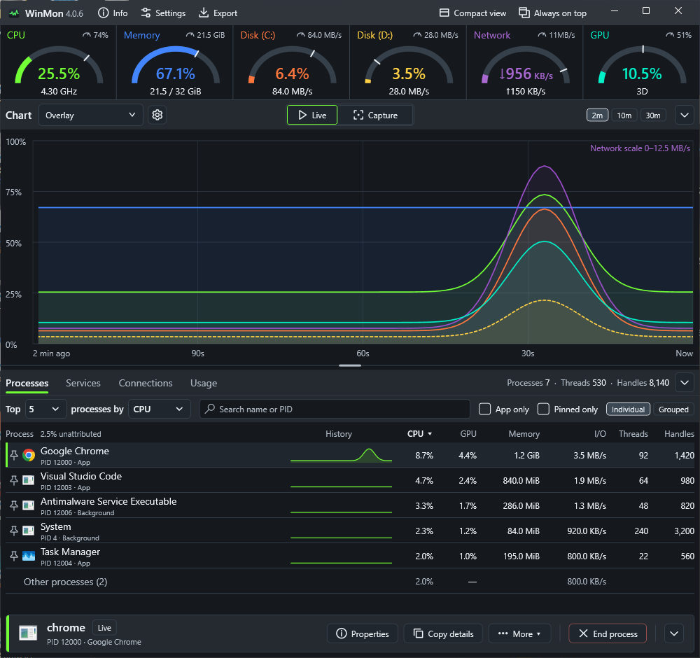
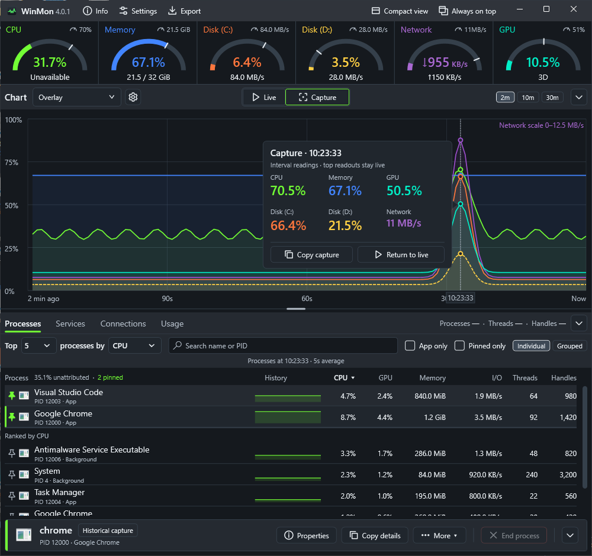
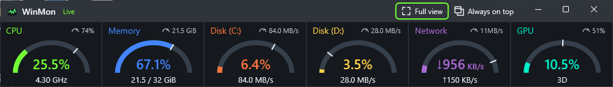

# WinMon

**See what your PC is doing. Find what's slowing it down.**

WinMon brings CPU, memory, disk, network and GPU activity into one Windows dashboard. Spot a spike, find the busiest processes and services, and look back at what was happening when it occurred.

**Windows x64 · No separate .NET installation · Installer or portable ZIP · MIT licensed**

[**Download latest release**](https://github.com/galenblakeman/WinMon/releases/latest) · [User guide](docs/USER-GUIDE.md) · [Screenshot gallery](docs/example/README.md) · [Report an issue](https://github.com/galenblakeman/WinMon/issues)



*Actual WinMon UI with illustrative data. [Browse the gallery](docs/example/README.md) for more views and capture details.*

## Download and requirements

[Download the latest release](https://github.com/galenblakeman/WinMon/releases/latest), then choose:

| Download | Get started |
| --- | --- |
| **Installer** | Install for your Windows account, then launch from the Start menu. |
| **Portable ZIP** | Extract into a writable folder and run `WinMon.exe`. Preferences stay beside the app. |

WinMon ships as a self-contained **Windows x64** app, so you do not need to install .NET separately. The desktop installer accepts Windows 10 version 1607 (build 14393) or later. This packaging minimum is not a compatibility test: use a Windows edition and version supported by [.NET 10](https://github.com/dotnet/core/blob/main/release-notes/10.0/supported-os.md). Older-Windows acceptance has not been verified for this build. See [platform details](docs/USER-GUIDE.md#platform-requirements) for distribution limits and the environment used for this refresh.

Ordinary resource monitoring and connection lists run without administrator rights. Optional per-app network traffic monitoring requires a separately installed service and administrator approval to install it.

## Investigate a spike

1. **Click a spike in the chart** to inspect that recorded moment. WinMon keeps recording while you look back.
2. **Inspect the process rankings** to see which apps were busy. Group related processes, search, or pin an app to follow it.
3. **Choose Copy capture** to share the timestamp, resource readings and displayed process rows as plain text.



*In this illustrative workload, Chrome's CPU activity rises during the selected spike and falls afterward. Resource readings describe the selected interval; process CPU uses a five-second average. The gauges at the top remain live.*

History defaults to **30 minutes**, with retention configurable up to **60 minutes**, subject to memory limits. Optional **Automatic captures** mark threshold events and save text reports while you are away. [Learn about history and captures](docs/USER-GUIDE.md#catch-the-spikeeven-after-it-passes).

## Explore your system

| Feature | What it helps you do |
| --- | --- |
| **Resource charts** | Compare CPU, memory, disk, network and GPU activity on a shared timeline. Choose overlay, small multiples, heatmap, focused resource or logical processor charts. Each view remembers its preferences. |
| **Processes** | Rank by CPU, GPU, memory, I/O, threads or handles. Group processes by executable, search, and keep important apps pinned. |
| **Services** | Follow Windows services, their hosts and observed workers. Inspect resource use or start, stop and restart eligible services with confirmation and elevation where required. |
| **Connections** | See apps with TCP connections and UDP endpoints. Optional per-app traffic monitoring adds receive/send rates, history and observed byte totals. |
| **Usage** | Find which apps consumed CPU time, I/O and GPU time during the session, including apps that have exited. |
| **CSV export** | Save retained resource, process, service and connection observations, or session usage totals, for analysis. Connection exports contain endpoints and owners, not traffic counters. |
| **Hardware and help** | Open Info for hardware details, feature instructions and a walkthrough that points out controls in the dashboard. |

[See feature examples](docs/example/README.md#investigate) · [Read the user guide](docs/USER-GUIDE.md)

## Command-line preview

The source tree includes a separate Windows terminal app, `winmon-cli`, using Spectre.Console and System.CommandLine. Build it with the .NET 10 SDK; it is not yet included in release downloads:

```powershell
dotnet build src/WinMon.Cli/WinMon.Cli.csproj -c Release -m:1 -p:UseSharedCompilation=false
$cli = './src/WinMon.Cli/bin/Release/net10.0-windows/winmon-cli.exe'
& $cli
& $cli watch --grouped --apps-only --top 20
& $cli watch --tab services --sort memory
& $cli watch --tab connections
& $cli snapshot --sort memory --top 15
& $cli snapshot --filter chrome --format json
```

`watch` is a read-only, keyboard-driven app with four tabs:

| Key | Tab | Sorting and filters |
| --- | --- | --- |
| **F1** | **Processes** | CPU, memory, GPU, I/O, threads and handles; executable grouping, text/PID search, App only, session pins and Top/All. Individual memory is working set; grouped memory sums private bytes. |
| **F2** | **Services** | CPU/private memory/I/O/name; search, all/running/stopped status and host/worker totals. Name sorting requires All. Details identify shared services, hosts and worker processes. |
| **F3** | **Connections** | Receive/send rates, received/sent totals and TCP/UDP counts; owner/PID/address/port search, App only, pins and traffic periods. Details list endpoint protocols, addresses, ports and TCP states. |
| **F4** | **Usage** | CPU time, cumulative I/O, GPU time, process lifetimes and last activity; search and App only. Share uses the same total-machine busy-time denominator as the desktop. |

Use **1–6** to sort; each sortable column heading shows its digit. Use **/** to edit the current tab's filter (Enter applies; Esc cancels or clears), **Up/Down/Page/Home/End** to select rows, and **Left/Right** to reveal additional columns. Numeric watch-table columns align to the right. The filter line appears only while a filter is being edited or is set. A column-navigation hint appears on the status line when columns are hidden. The first column takes the spare width, grouped processes show their member count (for example `×12`; Enter lists the PIDs), and the status line and key hints stay at the bottom of the terminal. The active tab has a `>` marker, including without color. The selected sort metric is brought into view automatically. **Enter** opens details; arrows/Page keys scroll, Left/Right pan long lines, and Esc returns. Each tab retains its own controls and selection.

**G** toggles process grouping, **A** App only, **T** cycles Top 5/10/15/20/50/All, **P** pins/unpins the selected application/service and **N** toggles Pinned only. Pins with a known executable path follow that executable across restarts, including its current PIDs in individual view; service pins use service names. Rows without a stable path remain session-only pins. A reused PID belonging to another executable cannot inherit a saved pin. In Services, **S** cycles status and **W** includes/excludes workers. In Connections, **R** cycles traffic periods: since start, 1 minute, 5 minutes and 30 minutes. **?** opens the full key guide.

**Space** freezes the displayed observations, including averaging windows, usage totals and health indicators, while collection continues. Press again to return to live data. Process and service CPU/I/O use the desktop's five-second window; GPU averages readable intervals and memory/counts use current observations. Usage remains cumulative rather than a five-second measurement. Startup, gaps, unavailable counters and partial traffic coverage are preserved. **Q** exits; **Ctrl+C** cancels. Both restore the terminal screen and cursor.

At 120 columns and 32 rows, the resource summary shows five panels in CPU, Memory, Disk, Network, GPU order. Titles, values, bars and histories share their resource color. CPU, memory, disk and GPU lead with percentages; Network leads with download speed and automatically scales to recent traffic. Below each bar: CPU clock in GHz, used/total RAM in GiB, disk throughput in MB/s, upload speed, and GPU memory or 3D. Histories cover 60 seconds, preserve gaps, and freeze with Space. The process table shows numeric metrics without a History column. Unavailable table values appear as a dash (—). The five-panel view ends at the boxes, leaving more process rows visible. Compact terminals keep two gauge lines and detail rows; the 80x20 minimum keeps a numeric summary. Network uses download-rate units in every layout.

Interactive output uses UTF-8 so gauges and sparklines render as Unicode even when the shell starts with a legacy Windows code page. The CLI restores the original output encoding on exit; redirected output keeps its inherited encoding. Use a font with Unicode block characters, such as Cascadia Mono or Consolas.

The CLI header includes its build version (for example, `WinMon 4.0.6`). Keyboard shortcut hints use soft cyan (`#7DCFFF`) key names inside grey brackets. Summary accents match the desktop reference: lime CPU, blue memory, yellow disk, purple network and teal GPU. The selected table row is highlighted across its full width. Values, gauge bars and resource histories share the corresponding color in every layout. `--no-color` and `NO_COLOR` keep the same readable text without resource colors.

Toggles show their state after the label (`☑`/`☐`, or `[x]`/`[ ]` without Unicode). The Memory history zooms to the range it covered in the last 60 seconds and its caption gives that range. A dark-blue highlight (`#264F78`) with light text marks the active tab and selected row; an arrow marks the active sort column. Enabled/live states are green (`#3FB950`), pins and paused/incomplete states gold (`#D29922`), and failures red (`#FF7B72`). Text labels, brackets, arrows and row markers preserve meaning with `--no-color` or `NO_COLOR`. Normal text/background use the terminal defaults; the accent palette targets dark terminals, and Spectre adapts colors to the terminal's supported color depth.

Interactive settings are saved separately from desktop settings in `%LOCALAPPDATA%\WinMon\cli-settings.json`: the last tab, per-tab sort/Top/App only/Pinned only, process grouping, Services status/Workers, Connections traffic period, network-monitoring preference and executable/service pins. Filters, selection, scrolling, details and pause are temporary. Keyboard changes save after a short debounce and on normal quit/Ctrl+C. Concurrent sessions merge changed controls instead of replacing each other's entire settings.

Explicit arguments override saved settings for that launch without saving those overrides. For example, `watch --tab connections --top 10 --network=false` temporarily changes the selected tab, its row limit and traffic subscription. Boolean options accept `--grouped=false` and `--apps-only=false`. Later keyboard changes save only the controls actually changed. An explicit finite Services limit falls back from a saved Name sort to CPU; explicitly requesting Name still requires All. `watch --no-save` loads preferences but does not save any interactive changes. `snapshot` remains independent of these preferences.

Use `settings show` to inspect saved settings, `settings reset` to restore defaults, and `settings set --network=true` or `--network=false` to change the saved traffic-monitoring preference. Saving this preference does not install or start a service; explicit `network install`/`network start` commands remain separate. Read/write failures show a warning while monitoring continues, and invalid JSON is preserved before replacement.

Displayed memory uses the desktop's adaptive binary units (B, KiB, MiB, GiB, TiB). Table I/O and connection rates/totals use decimal byte units (B, KB, MB, GB, TB), and the network summary uses the desktop's adaptive KB/s–GB/s readout. Units appear beside each value in tables, details and text snapshots; for example, `2,048.0 MiB` becomes `2.0 GiB`, and small rates remain visible as `100 B/s`. JSON retains raw bytes/bytes per second and schema version 1.

The terminal requires ANSI support and at least 80 columns by 20 rows. Narrow layouts truncate rows and pan columns; all values and identities remain available through details. `watch` defaults to All (`--top 0`); finite startup limits may be 1–1000. All retains more process history and uses more memory. Resource/connection history is bounded to at most 30 minutes and the existing entry budgets, so requested traffic periods can have shorter coverage on busy systems. Service observations retain the existing two-minute window.

Endpoint lists work without the optional traffic service. Network monitoring is enabled by default unless saved settings disable it. Use `--network=false` to disable it for one launch, or `settings set --network=true` to enable a previously disabled preference. Monitoring subscribes to an already-installed, authenticated local service and can start that installed service; it never installs, repairs or removes it. Outages retry every five seconds and a protocol mismatch requests an update. Missing or incomplete rates are not shown as zero. Without traffic collection, Connections falls back to TCP ordering while retaining the chosen sort preference.

Connections rows group the same executable's processes, matching the desktop. Traffic stays in Connections. Use `winmon-cli network start` to start and check an installed service. If it is missing, incompatible or not authorized for your account, explicitly run `winmon-cli network install` to install/repair, authorize the requesting account, start and verify it through the desktop's signed setup flow and administrator approval. Then run `winmon-cli watch --tab connections`. Setup requires a CLI build containing the signed service bundle; source builds without it explain how to enable monitoring through desktop WinMon. Store builds cannot run these service-management commands. Monitoring never triggers installation automatically, and setup does not save a desktop preference.

`snapshot` takes a baseline, waits one second, then prints a table or JSON and exits. It supports the six process sorts, text/PID filtering and `--top 0` for All; it intentionally reports one measured interval. JSON uses raw bytes/bytes per second, explicit null readings and schema version 1. Use `--no-color` or `NO_COLOR` to suppress colors; redirected tables have no ANSI styling. Redirected `watch` output is rejected; use snapshots for scripts. Exit codes are 0 for a completed report/normal quit, 1 for failure, and 130 for cancellation; invalid arguments return a nonzero code.

The monitoring views do not terminate processes, change priority, control arbitrary services or create dumps. The explicit `network` commands manage only WinMon's network service. Process paths, publishers and endpoint details stay local unless you share the output.

## Compact view and customization

Switch to **Compact view** to keep resource readings visible in a slim window. Enable **Always on top**, minimize to the notification area, or show and hide WinMon with a configurable shortcut (**Ctrl+Shift+M** by default).



Choose light, dark or additional appearances, independent chart palettes and seven gauge options, including None. Settings previews the combination before you save. A Colorblind palette adds distinct line patterns. The interface is available in ten languages.

[Compare appearances and palettes](docs/example/README.md#customize) · [Customize WinMon](docs/USER-GUIDE.md#make-it-yours)

## Permissions and limitations

- **Optional network service:** Signed desktop builds can install per-app traffic monitoring through the installer or Settings → Network. Installation and maintenance can request administrator approval. Microsoft Store builds do not offer this service. Endpoint lists remain available without it.
- **Measurement limits:** Disk percentages measure active time; process I/O includes files, network and devices. GPU utilization reports the busiest engine. Very short-lived processes and collection gaps can leave activity unattributed or incomplete. Machines with multiple active processor groups are unsupported.
- **History:** Available history can be shorter on busy systems. Resource and process history can optionally survive normal restarts; service and connection history start fresh. Usage tracks the current session, with continuity across in-app updates.
- **Local data:** Preferences, captures, exports and diagnostic logs stay on this device unless you share them. Exports can contain process paths, service names and network addresses. See [Privacy](docs/PRIVACY.md).
- **Process and service actions:** Ending a process can lose unsaved work. Service changes can affect other applications. WinMon confirms destructive actions and respects Windows permissions.

WinMon samples once per second and skips drawing while hidden or minimized. A November 9 sample of WinMon 4.0.6 averaged **0.25% CPU** and **162.5 MiB working set** on a 12-thread desktop. This was one 150-second run with history still filling and optional per-app network monitoring off. Overhead varies with hardware, process count, history and enabled features; see the [measurement conditions](docs/PERFORMANCE-HISTORY.md#readme-refresh-profile-november-9-2026) and [profiling method](docs/DEVELOPMENT.md#performance).

## Documentation and source build

- [User guide](docs/USER-GUIDE.md): settings, measurements, captures, exports and updates.
- [Screenshot gallery](docs/example/README.md): examples grouped by task and appearance.
- [Developer guide](docs/DEVELOPMENT.md): architecture, tests, diagnostics and performance.
- [Updates](docs/UPDATING.md), [code signing](docs/CODE_SIGNING.md) and [release packaging](packaging/RELEASING.md).

Development uses **.NET 10**, with SDK **10.0.402** pinned in [global.json](global.json) and latest-patch roll-forward.

```powershell
dotnet run --project src/WinMon/WinMon.csproj -c Release -m:1 -p:UseSharedCompilation=false
```

To publish a self-contained executable:

```powershell
dotnet publish src/WinMon/WinMon.csproj -c Release -m:1 -p:UseSharedCompilation=false
```

Output: `src/WinMon/bin/Release/net10.0-windows/win-x64/publish/WinMon.exe`.

WinMon is built with C# and WPF and released under the [MIT License](LICENSE). Official executable and installer releases use Azure Artifact Signing with publisher Galen Blakeman; see the [code signing policy](docs/CODE_SIGNING.md) for verification.

[Report a problem or suggest an improvement](https://github.com/galenblakeman/WinMon/issues).

Copyright © 2026 Galen Blakeman.

Running `winmon-cli` without arguments opens the interactive monitor with saved preferences, just like `winmon-cli watch`. Use `winmon-cli --help` for the command list; launch options still follow `watch`.

Press **B** in any watch tab to enable or disable network traffic monitoring. The change is saved unless `--no-save` is active. Disabling releases only this CLI subscription; enabling connects to the installed service without installing or repairing it. Search-filter editing treats B as text.

Fresh CLI settings (including after `settings reset`) default to Top 10 on all four watch tabs. Existing saved row limits, including All (`0`), are preserved; `--top` overrides the active tab for one launch.
