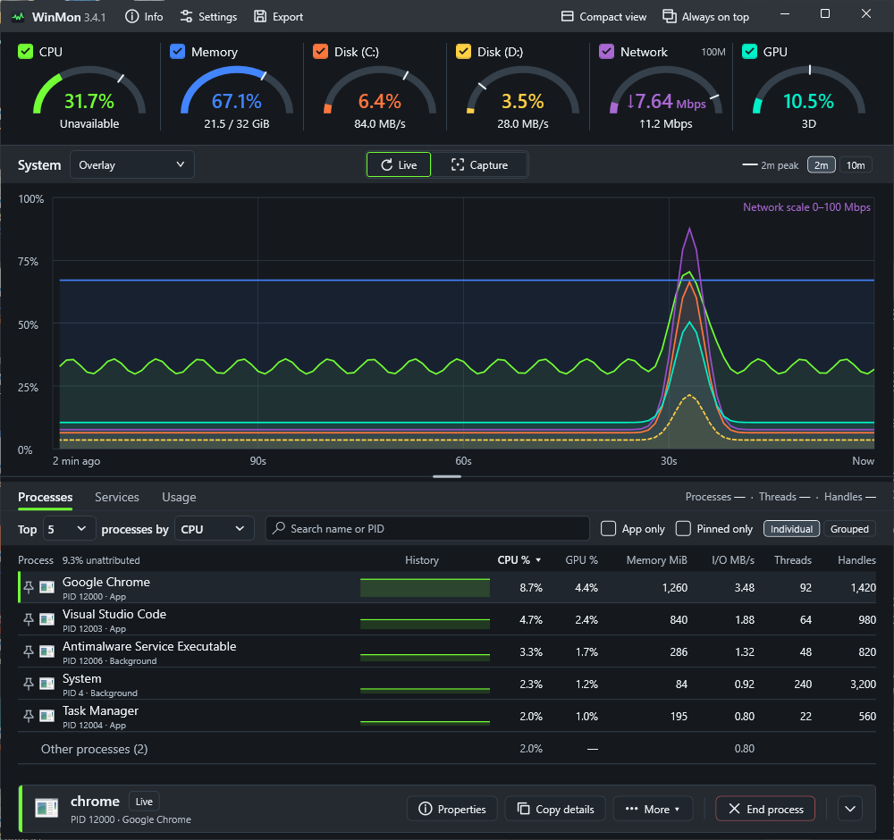
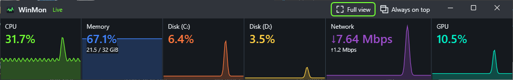
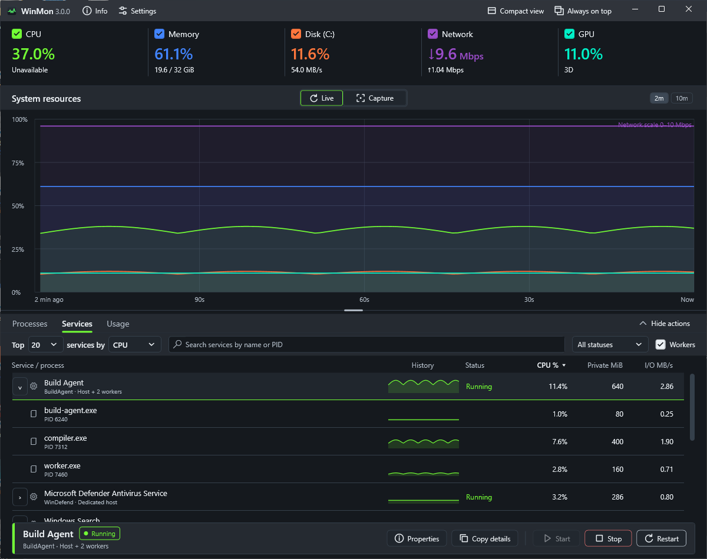
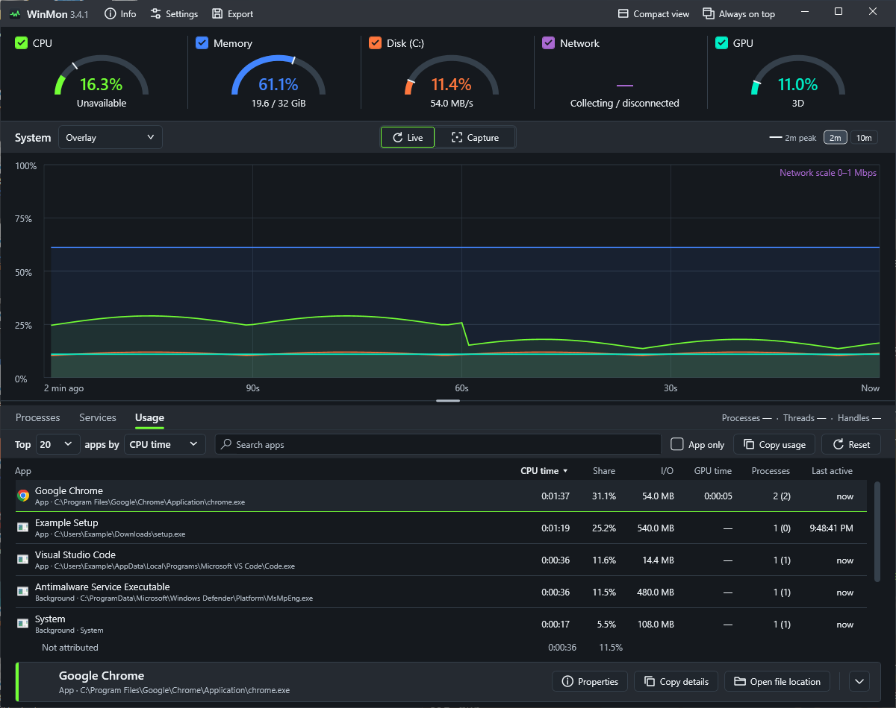
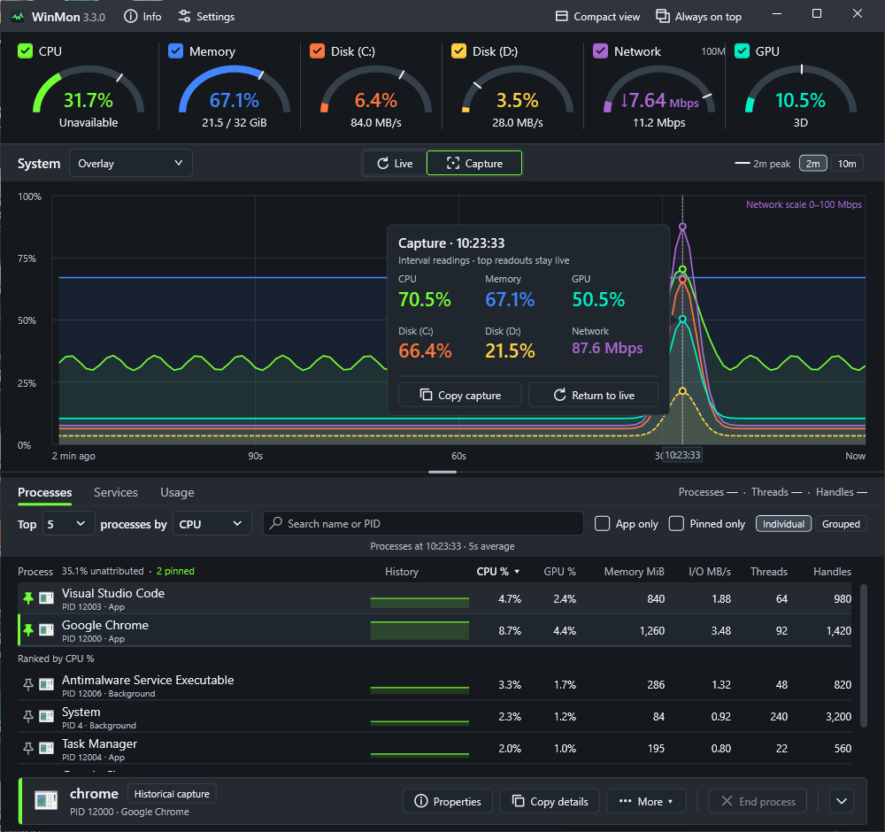
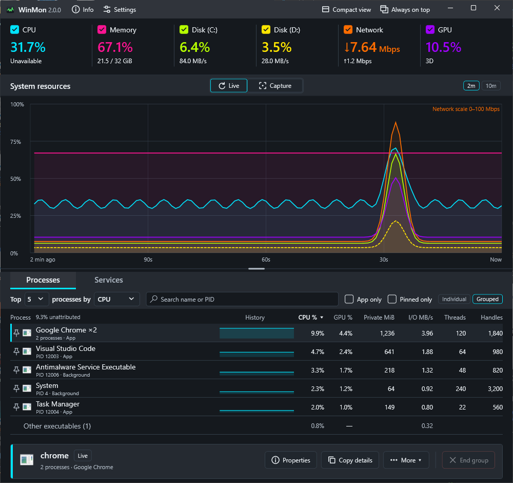
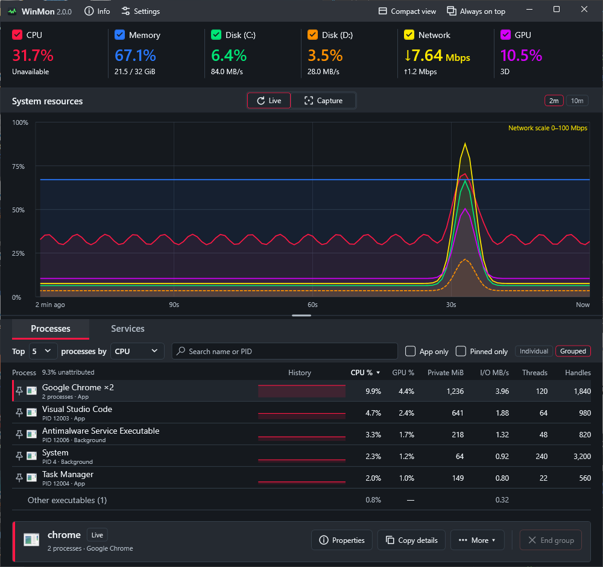
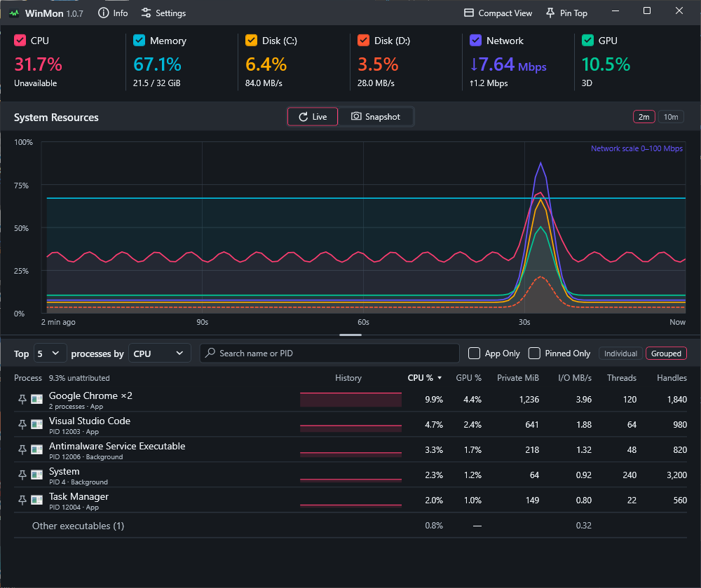
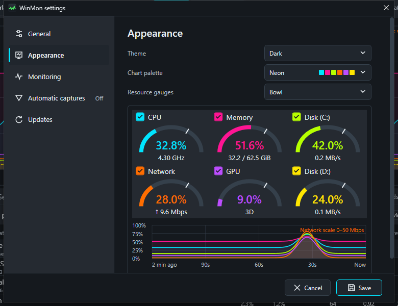
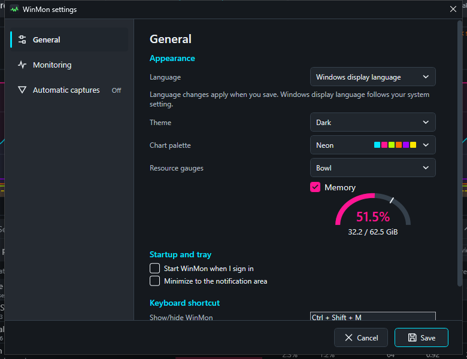

# WinMon

**See what your PC is doing. Find what's slowing it down.**

WinMon brings CPU, memory, disk, network and GPU activity into one clear Windows dashboard. Spot a spike, find the busiest processes and services, and look back at what was happening when it occurred—all from the same window.

**Windows x64 · Self-contained app · Portable settings · MIT licensed**

[**Download latest release**](https://github.com/galenblakeman/WinMon/releases/latest) · [Get started](#get-started) · [Developer guide](docs/DEVELOPMENT.md) · [Privacy](docs/PRIVACY.md) · [Code signing policy](docs/CODE_SIGNING.md)



*Screenshots use illustrative sample data. See the [example gallery](docs/example/README.md) for more views, capture dates and version details.*

## Get started

[Download the latest release](https://github.com/galenblakeman/WinMon/releases/latest), then choose how to run WinMon:

| Option | How it works |
| --- | --- |
| **Installer** | Install for your Windows account, with a Start menu entry and an uninstaller. |
| **Portable ZIP** | Extract into a writable folder and run `WinMon.exe`. The included `portable.flag` keeps preferences beside the app. |

WinMon targets **Windows x64** and bundles its .NET runtime, so no separate .NET installation is required. Monitoring runs without administrator rights or a network service.

For a standalone executable, create an empty `portable.flag` beside `WinMon.exe` before launching to enable portable settings. Otherwise, preferences are saved in `%LOCALAPPDATA%\WinMon\settings.json`.

Developers can also create an [MSIX / Microsoft Store build](packaging/msix/README.md) using the packaging tools. Store builds use Store-managed updates instead of the GitHub updater.

## Your system, at a glance

Keep the whole picture in view while you work, play or troubleshoot. WinMon puts live resource readings above a shared timeline, so you can see how CPU spikes, disk activity and network transfers line up.

- **Watch the resources that matter.** Monitor CPU, physical memory, GPU, network throughput and up to two disk volumes. Hide individual chart traces to focus the view while recording continues.
- **Compare now with a recent spike.** In Full view, a gauge with each resource reading shows its current level; the dark line marks its highest reading over the last two minutes. The network gauge shows download throughput on an automatically chosen two-minute scale, and the arc styles print the top of that scale, such as **100M**. An unavailable reading leaves its gauge empty.
- **See why a tile changed.** Hover a resource tile, or focus its chart toggle or compact box, for live CPU, memory, disk, network or GPU details.
- **Find the busiest processes.** Rank by CPU, GPU, memory, I/O, thread count or handle count, with application icons and history sparklines that follow your selected metric.
- **Look beyond the latest number.** Switch between 2, 10, 30 and 60-minute chart ranges, subject to your retained history, and inspect earlier samples.
- **Choose how history looks.** One chart dropdown offers the original overlaid traces, aligned small charts, a heatmap timeline, and Focus choices for each configured resource. The small charts, heatmap and Focus views fit their axis and resource labels into one narrow column beside the plot. Disk choices include their drive letters. Choosing a hidden Focus resource shows it again. WinMon remembers the selection. Chart clicks, Capture mode and automatic capture markers work in every view.
- **Keep it close.** Enable **Always on top** in the title bar to keep WinMon above other windows, minimize it to the notification area, or bring it forward with a configurable shortcut. Its highlighted background shows when it is enabled.
- **Use less screen space.** Choose **Compact view** in the title bar for the same live resource gauges, colors, details and two-minute peak marks shown in Full view. Its resource names replace the chart-series checkboxes because the chart is hidden. The selected gauge style, including **None**, applies to both views. **Full view** restores the dashboard and its size. The selected view is remembered when WinMon closes.



## See the app behind the processes

Browsers and other applications often spread their work across many processes. Switch to **Grouped** to bring processes from the same executable together and see their combined CPU, memory and I/O activity. Switch back to **Individual** when you need to investigate a specific process.

Grouped GPU shows the busiest member; grouped memory uses private bytes to avoid counting shared working-set pages repeatedly.

## Find the process you need

Search the ranked list by application name, executable name or PID. Turn on **App only** to focus on processes observed with an application window, and use the **App** / **Background** labels to understand each row. In Grouped mode, an executable is an app when any current member has an app window.

Click the **Threads** or **Handles** column heading to rank by that count. Hover over a process name for its publisher metadata and executable path.

**Pin a process** using the pin beside its name or its row menu. Pinned rows stay above the rankings in pin order and do not count toward the Top N limit. Turn on **Pinned only** to focus on them. Pins and the Pinned only filter are saved when WinMon closes and restored when it reopens.

<details>
<summary>How pins behave across restarts and history</summary>

Individual processes and executable groups have separate pin lists. An individual pin follows one process lifetime, so an exited or restarted process stays marked exited and a reused PID cannot inherit it. Executable-group pins match new instances of the same executable.

Search and App only filter both pinned and ranked rows. Pinned processes do not appear twice. Missing historical observations show “Not recorded at this sample”; gaps or uncertain observations show unavailable values. Thread and handle counts show the latest observation at the selected moment.

</details>

See [grouped, filtered and pinned process views](docs/example/README.md) in the example gallery.

Select a process row to use the accent action bar: **Properties**, **Copy details**, **More**, and **End process** (or **End group**). **More** includes **Open file location** and memory-dump creation for eligible live processes. The same actions, plus pinning, remain available by right-clicking a row. Selection follows the process lifetime even when it falls out of the rankings or is filtered out; a reused PID cannot take over the selection. Group selections follow the executable, and switching between Individual and Grouped clears selection. Process termination retains its confirmation. Available actions depend on the selected process, Windows permissions, and whether you are inspecting history.

To make room, click the chevron at the end of the action bar. The bar slides away and leaves a slim strip with the selection's name; click **Show actions** to bring it back. Processes, Services and Usage share the choice, and WinMon remembers it.

Beside the **Processes**, **Services** and **Usage** tabs, WinMon shows the machine's process, thread and handle counts for the moment the table shows, live or captured. Counts of 100,000 or more are shortened, such as **152K**; hover for exact values.

## Follow Windows services and their workers

Choose **Services** beside **Processes** to inspect local Windows services, including stopped services. Expand a service to see its hosting process and observed workers. CPU, private memory and read/write I/O totals follow the **Include worker processes** toggle; each metric row has a CPU history sparkline.

CPU and I/O values and rankings use the same five-second averaging window as Processes. Private memory uses the latest sample; sparklines show individual recorded intervals.



*Illustrative service identities and measurements, captured from the native WinMon window.*

Search by service name, display name, process name or PID, filter by status, and sort by CPU, memory, I/O or name when showing all services. Services sharing a host appear under one host total, with no separate resource attribution to each service. Worker relationships are inferred from observed process ancestry.

The **Top … services by …** toolbar defaults to 20 service/host rows, with choices from 5 to 50 and **All**. Click a CPU, private-memory, I/O or Name column header to change sorting; Name sorting is available with **All**. The dropdown and active-column arrow stay in sync. Search and status filters apply before the limit; expanded workers do not count against it. The search field grows with the window, and controls wrap below the ranking selectors when space is limited.

The selected service stays in the action bar when ranking or filters hide its row. Its status and action targets continue to refresh, including after a host restart. Selecting another row changes the target; historical or unavailable data disables service controls.

The service action bar offers **Properties**, **Copy details**, **Start**, **Stop** and **Restart**. Properties opens a read-only detail window. Right-click a service or process row for **View process**, **Copy details**, **Start**, **Stop** and **Restart**. Right-click selects the row; the menu keeps its captured target if the rankings change. Shared-host and process rows disable individual service controls. Service controls use the same availability checks and confirmations as the action bar.

**View process** opens the corresponding PID in the process view. **Copy details** copies the selected service or process identity, status, observation time, resource metrics, and associated services/processes, including while inspecting history. Start, Stop and Restart operate on the selected service; Stop and Restart require confirmation, and Windows requests elevation when needed. Service controls are disabled while inspecting history. Service history retains up to two minutes, subject to a separate memory bound; older service captures are unavailable. Driver services are outside this view.

## See what used your PC this session

Choose **Usage** beside **Processes** and **Services** to see each app's total **CPU time**, **I/O** and **GPU time** since WinMon started, including apps that have already exited. Rows group processes by executable, like **Grouped**, and show how many processes each app ran and when it was last active.

**Share** compares an app's CPU time with all the time the machine was busy. **Not attributed** at the bottom holds busy time WinMon could not assign to an app, such as processes that started and exited between samples. Rank by any column, search by name or path, turn on **App only**, and use **Copy usage** for a plain-text report. **Reset** starts the totals again from now.

Select an app for **Properties**, **Copy details** and **Open file location** in the action bar. Properties opens a read-only detail window. Right-click an app for **Show in Processes**: a running app opens live with its group selected, and an exited app opens Capture at the moment it was last active, while that moment is still in history. Totals continue across in-app updates and are cleared when WinMon exits.



## Catch the spike—even after it passes

Choose **Capture** in the centered **Live | Capture** switch above the chart to inspect the newest recorded sample, or click the chart to select an earlier moment. The capture shows resource readings for that interval, and the process table follows your selection so you can investigate what was busy then. Recording and the top readouts stay live while you explore.



Click **Capture** again to select the newest sample. Use **Left / Right** to step through samples, **Home** to jump to the oldest visible sample, and **Live**, **End**, **Escape** or **Return to live** to resume the live view.

**Copy capture** always copies the selected moment’s resource summary and displayed top process rows as plain text, preserving their sorting, grouping and filters. Reports include the timestamp and time zone, units, unavailable readings and averaging notes. Copying keeps the capture open; expired samples cannot be copied.

History is kept in memory for the current session, with configurable retention up to 60 minutes. Available history can be shorter on busy systems and is cleared when WinMon exits, except across an in-app update.

### Automatic captures

Turn on **Automatic captures** in Settings to catch spikes while you are away. Each resource has a rule, such as **CPU above 90% for 10 s**, plus **Any one process** for a single runaway process, measured in percent of one core. When a rule holds, WinMon marks the moment with a triangle in that resource's color at the top of the chart and saves the Copy capture report for the peak as a text file. A rule waits for its cooldown, and for the value to drop clearly below the threshold, before it captures again.

Click a marker, or choose a capture from **Automatic captures** in the chart header, to open Capture mode at the peak; **Ctrl+Left** and **Ctrl+Right** step between captures. The capture card names the rule and offers **Open report**. Once a peak leaves history, its marker opens the saved report instead. Reports go to `%LOCALAPPDATA%\WinMon\Captures` (or a `Captures` folder beside a portable copy) unless you choose another folder; WinMon keeps the newest 200 and deletes only its own reports. Disk and network reports list processes by total I/O and say so, because Windows does not break process I/O down by drive or adapter. A notification for each capture is optional.

## Make it yours

Choose **Light**, **Dark**, **System**, **Brushed steel**, **Copper**, **Gunmetal**, or **Brushed nickel** appearance, then pick a chart palette independently. The four metal appearances change surfaces and chrome while keeping the same layout and resource gauge style. Options include Classic, Ocean, Colorblind, high-contrast, **Neon**, **Arcade** and **Tropical** palettes. Settings includes swatches and descriptions to help you choose. Colors stay consistent across resource readings, chart traces and process sparklines.

The selected Settings section uses light text and icons against its blue highlight in Light appearance.

Choose how the resource gauges look under **Resource gauges** in Settings: **Bowl** (the default), **Needle**, **Segmented arc**, **Left bar**, **Bottom bar**, **Segmented bar** or **None**. A preview beside the choice shows the style before you save. Every style keeps the same height, so the chart doesn't move when you switch. **Bowl** and **Segmented arc** hold the reading inside a nearly round arc, with the detail line below. **Needle** draws a half-circle dial with the reading underneath; its detail line, such as clock speed or memory in use, appears when you hover the tile. **None** hides the gauges and their legend.

See [Light appearance and additional palettes](docs/example/README.md) in the example gallery.

<details>
<summary>Compare palettes and view Settings</summary>

| Neon | Arcade | Tropical |
| --- | --- | --- |
| [](docs/example/example_neon.png) | [](docs/example/example_arcade.png) | [](docs/example/example_tropical.png) |

The three custom palettes keep their supplied colors in both themes. Open an image for the full-size view.



The Settings image above is from the installer/portable configuration. Store builds hide the GitHub update controls and use Store-managed updates:



</details>

Settings is organized into **General**, **Monitoring** and **Automatic captures** sections in a sidebar, plus **Updates** in installer and portable builds, with one Save for all of them. Choose disk volumes, history retention, automatic captures, startup at sign-in and notification-area behavior there. The default show/hide shortcut is **Ctrl+Shift+M**.

Choose **Windows display language** or select English, Simplified Chinese, Russian, Spanish, Brazilian Portuguese, German, Japanese, French, Polish or Korean in Settings. Language changes apply when you save.

Need a hardware overview? **Info** brings together CPU, RAM, graphics adapters, physical drives, local volumes and network adapters. Expand the details or copy the report to share when troubleshooting.

## Light on your system

A monitor shouldn't become the thing slowing your PC down. WinMon samples once per second and collects process resource counters in one system query. Executable paths are cached for each process lifetime. When hidden or minimized, it keeps recording but skips drawing.

Example measurements from October 20, 2026, using a published build on a 12-thread desktop with about 1,250 running processes and a full 10-minute history. These results came from one 11-minute run:

| Measurement | Example result |
| --- | ---: |
| CPU | about 0.25% of the machine |
| Memory (working set) | about 146 MiB |
| Private memory | about 60 MiB |

Separate startup measurements on that machine recorded a median of about **0.6 seconds** for the uncompressed published executable.

These measurements predate the current release. Longer history retention uses more memory, and results vary with process count and hardware. See the [measurement notes](docs/PERFORMANCE-HISTORY.md#allocation-gc-and-compression-october-20-2026) for the benchmark context and the [developer guide](docs/DEVELOPMENT.md#performance) to measure your own system.

## Updates

Installer and portable builds check GitHub for newer stable releases and offer **Update now** in the footer when a verified update is available. The footer stays at the bottom of the window however short it is, and keeps **Update now** after a cancelled or failed download so you can try again. **Update now** checks once more first, so it installs the newest release even if another was published after the offer appeared. The updater downloads the update, saves preferences, exits, and restarts at the same location. History recorded before the update is kept, so the chart and Capture mode continue after the restart; updating from 2.0.4 or earlier starts with empty history, because those versions do not save it. Settings includes a manual check and an option to disable automatic checks. Store builds disable these controls and use Store-managed updates.

In-app updates require a release signed with the update key already trusted by your copy of WinMon. Earlier copies without the updater require a manual upgrade. See [update setup and behavior](docs/UPDATING.md) for publishing and recovery details.

## Build from source

Development uses **.NET 10**, with SDK **10.0.402** pinned in [global.json](global.json).

```powershell
dotnet run --project src/WinMon/WinMon.csproj -c Release
```

To produce the self-contained executable:

```powershell
dotnet publish src/WinMon/WinMon.csproj -c Release -m:1 -p:UseSharedCompilation=false
```

The published app is at `src/WinMon/bin/Release/net10.0-windows/win-x64/publish/WinMon.exe`. See the [developer guide](docs/DEVELOPMENT.md) for tests, measurement details and diagnostics, or the [release guide](packaging/RELEASING.md) to build installer and portable packages.

## A few useful details

- Disk percentages show **active time**, rather than storage space used. Network throughput measures activity on the selected Ethernet/Wi-Fi adapter.
- GPU utilization reflects the busiest engine. Live GPU temperature and VRAM usage are outside this view.
- Unavailable readings appear as a dash and leave gaps in the chart. Very short-lived processes can exit between samples; process totals may not account for all system activity.
- Systems with multiple active processor groups are currently unsupported.
- To end a process, right-click a live **Individual** row and confirm **End process**. In **Grouped** mode, confirm the list to end all current processes in that group, including idle members. Processes started after confirmation opens are not included. Unsaved work can be lost; historical, system and WinMon rows cannot be terminated through this action.

## Open source

WinMon **3.2.1** is built with C# and WPF on .NET 10, and released under the [MIT License](LICENSE).

### Code signing policy

Official executable and installer releases use Azure Artifact Signing with publisher Galen Blakeman and a timestamp. Version 1.0.3 has recorded signature validation for both files. Older assets may be unsigned; check the downloaded file's **Properties → Digital Signatures**. See the [Code signing policy](docs/CODE_SIGNING.md) for verification and release responsibilities and the [privacy policy](docs/PRIVACY.md) for local data handling.

Found a problem or have an idea? [Open an issue](https://github.com/galenblakeman/WinMon/issues).

Copyright © 2026 Galen Blakeman.
