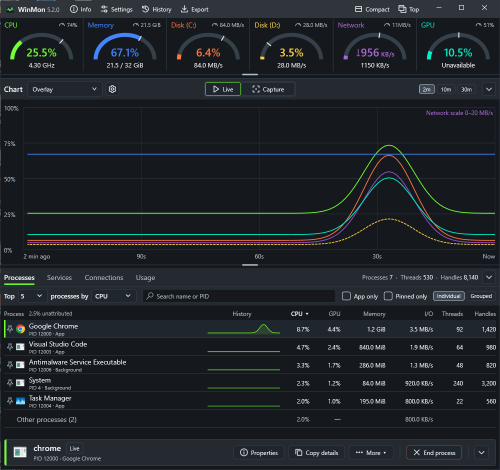
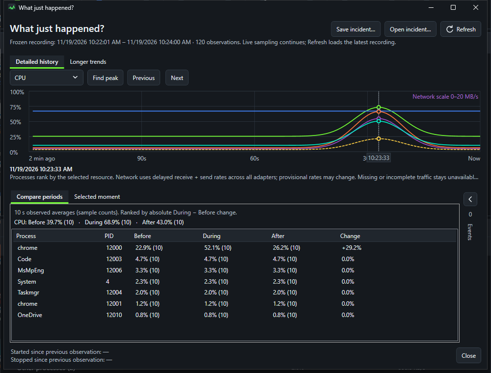
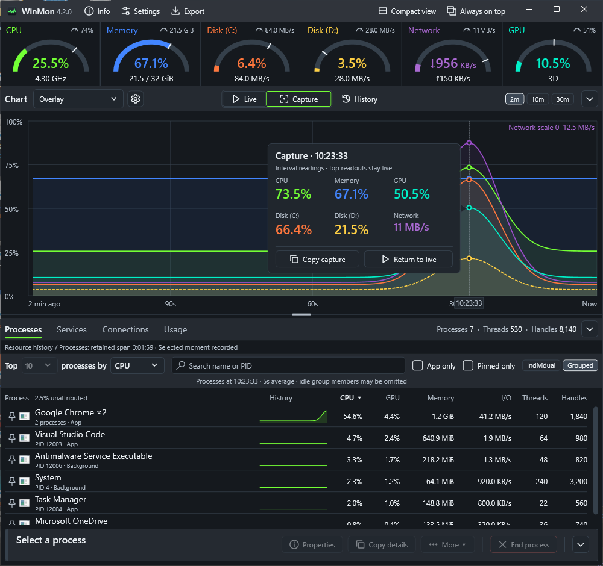
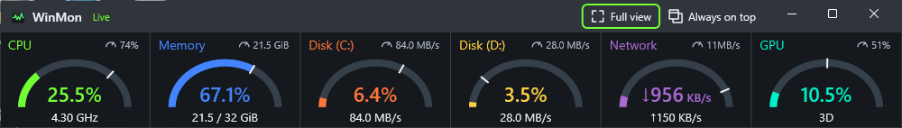

# WinMon

**See what your PC is doing. Find what's slowing it down.**

WinMon brings CPU, memory, disk, network and GPU activity into one Windows dashboard. Spot a spike, find the busiest processes and services, and look back at what was happening when it occurred.

Closing WinMon completes shutdown even when its pending work has already finished.

Sampling uses a dedicated worker with elevated scheduling priority on Windows to keep recording responsive under CPU load. Missing readings and genuine collection delays remain visible as chart gaps.

The CPU clock under the CPU gauge is the effective clock, as Task Manager reports it. It rises above the rated clock while boosting and falls at idle, including on processors where Windows reports only the fixed rated clock.

CPU details distinguish ten-minute temperature peaks from configurable CPU usage peaks and use short local times. Thermal-zone readings wrap in full; the CPU sensor-source row is omitted, and unrestricted CPU performance shows a no-limit status.

Unavailable optional memory-pressure counters leave the other resource readings working. Shared GPU memory readings retry after a temporary read failure.

Settings → **Devices** groups primary and secondary disk volumes, the network adapter, and GPU selection. GPU defaults to **Automatic**, following the busiest engine across all GPUs. Choose a specific graphics processor to keep its resource gauge and chart fixed to that device; process GPU readings still cover all GPUs. A missing selected GPU stays selected and shows unavailable readings until it returns or you choose another device. Changes apply when you save.

The GPU gauge shows temperature and power when the Windows graphics driver supplies both, with fan speed in its details. Disk gauges show drive temperature when Windows supplies a reading for the physical drive behind the volume. CPU details show available system thermal zones and report reduced performance when Windows supplies a limit. The optional desktop [hardware sensor service](docs/design/HARDWARE-SENSORS.md) adds CPU package temperature and available CPU and system fan speeds. Choose Celsius or Fahrenheit in Settings → Monitoring. Missing or stale sensor readings appear as unavailable.

MCP performance recordings retain valid captured intervals even when report processing falls behind collection.

MCP process recordings continue through temporary CPU collection failures. Failed executable-path lookups retry after 30 seconds, so friendly names, grouping and saved executable pins can recover while the process remains running.

Per-app network history retains rates collected while the interface is busy. After a temporary network-monitor disconnect, fresh rates can again contribute to History comparisons and automatic captures; session byte totals keep their incomplete-coverage warning.

Opening a new connection keeps established connections' traffic rates available while the new connection establishes its own baseline.

For a live individual process, **Properties** and **Copy details** read its command line, user/session/elevation and the signer of its executable file on disk. These details are read only on demand; command lines can contain secrets, so review copied text before sharing it.

The process **More** menu offers suspend/resume, CPU affinity and Efficiency mode for eligible live processes. Changes last for that process lifetime. WinMon asks before suspension and offers to resume its outstanding suspensions before closing or updating.

Memory details show paging reads per second, standby, modified, free/zero memory and the compression process working set when Windows exposes it. Capture text and resource CSV exports include these readings; unavailable values remain missing.

**Windows x64 · No separate .NET installation · Installer or portable ZIP · MIT licensed**

[**Download latest release**](https://github.com/galenblakeman/WinMon/releases/latest) · [User guide](docs/USER-GUIDE.md) · [Screenshot gallery](docs/example/README.md) · [Report an issue](https://github.com/galenblakeman/WinMon/issues)



*Actual WinMon UI with illustrative data. [Browse the gallery](docs/example/README.md) for more views and capture details.*

## Download and requirements

Current version: **5.0.1**.

[Download the latest release](https://github.com/galenblakeman/WinMon/releases/latest), then choose:

| Download | Get started |
| --- | --- |
| **Desktop installer / ZIP** | Choose `WinMon-<version>-Setup-x64.exe` or `WinMon-<version>-win-x64.zip`. Portable preferences stay beside the app. The ZIP includes signed CLI and MCP companions for older desktop updaters. |
| **CLI installer / ZIP** | Choose `WinMon-Cli-<version>-Setup-x64.exe` or `WinMon-Cli-<version>-win-x64.zip`. The installer offers optional user PATH integration. Run `WinMon.Cli.exe` from a terminal. |
| **MCP installer / ZIP** | Choose `WinMon-Mcp-<version>-Setup-x64.exe` or `WinMon-Mcp-<version>-win-x64.zip`. Both include the optional Claude Code plugin in `claude-code-plugin` beside the server; see [MCP setup](docs/MCP.md). The installer offers optional registration with existing Codex and Claude Code clients. |

CLI and MCP install independently. Run `update check` to check for a newer version or `update install` to download and start that product's installer. Portable copies download a verified ZIP for manual extraction after closing sessions. Desktop retains its in-app updater, including support for legacy bundled desktops when the release carries legacy signed metadata and companion payloads. The desktop ZIP includes CLI/MCP for those older updaters; its installer refreshes existing bundled tools but does not add them to fresh desktop installations. Follow [migration instructions](docs/INSTALLER-MIGRATION.md) before removing old tool copies or uninstalling desktop.

WinMon ships as a self-contained **Windows x64** app, so you do not need to install .NET separately. The desktop installer accepts Windows 10 version 1607 (build 14393) or later. This packaging minimum is not a compatibility test: use a Windows edition and version supported by [.NET 10](https://github.com/dotnet/core/blob/main/release-notes/10.0/supported-os.md). Older-Windows acceptance has not been verified for this build. See [platform details](docs/USER-GUIDE.md#platform-requirements) for distribution limits and the environment used for this refresh.

Ordinary resource monitoring and connection lists run without administrator rights. Optional per-app network traffic monitoring requires a separately installed service and administrator approval to install it.

The signed desktop installer offers unchecked options for per-app network monitoring and hardware sensors. Choosing **Hardware sensors** installs the official PawnIO driver package if needed, then installs and enables the signed sensor service for your account. Windows may request administrator approval for each setup step or a restart. Existing PawnIO installations are preserved, and removing WinMon does not remove PawnIO. To enable hardware sensors later, install official PawnIO first, then use Settings → Services. The Microsoft Store build omits these optional services.

## Investigate a spike

Click **History** beside **Capture** in the chart toolbar to open **What just happened?**. It freezes the retained recording and selects the CPU peak, with process contributors for that moment. Choose a resource and use **Find peak**, click the timeline or step through observations with the keyboard. WinMon keeps sampling; **Refresh** loads the latest recording in the same window. History tables use theme-aware row highlights and a separate keyboard focus outline to keep selected rows readable. The Events sidebar starts collapsed on the right, giving Compare periods and Selected moment more room. Expand it using the chevron, then drag its divider to resize it. WinMon remembers its width and collapsed state.

**Compare periods** shows observed averages for three adjacent 10-second windows around the selected moment, with sample counts and the 10 processes with the largest absolute change from before to during. **Selected moment** keeps the original process readings. Missing observations remain unavailable rather than zero; network process comparisons use retained received + sent rates, and process I/O does not identify a physical disk.



Choose CPU, memory, either configured disk, network or GPU. Network ranks contributors by retained received + sent rates across all adapters; process I/O includes file, network and device activity and does not identify physical disk traffic. Starts/stops appear only where adjacent inventories are complete and collection is continuous.

**Save incident…** lets you choose the range to export as a `.wmincident` file. By default it saves up to 30 seconds on each side of the selected point. Choose a wider range or **Entire recording** when needed. **Open incident…** reopens the file in History, including resource/process readings, app traffic and observed starts/stops. Live monitoring continues, and **Refresh** returns to the current recording. History also queries selected local Windows events when opened or refreshed, with severity markers, event details and explicit log coverage. Saved incidents include events within the export range and reopen without querying this PC. Files include process names, executable paths and event messages that may contain account or path names, so review them before sharing. Socket endpoints are excluded.

The **Crashes** summary groups recurring application crashes and hangs in the frozen History range. Select a group to highlight its events beside the recorded resource activity. Counts cover the retained Windows log; a faulting module identifies where a failure surfaced, without establishing its cause. Standalone reports are available through `WinMon.Cli crashes --days 30` and the MCP `list_crashes` tool, with log coverage and no executable paths or event messages.

For an investigation within the dashboard:

1. **Click a spike in the chart** to inspect that recorded moment. WinMon keeps recording while you look back.
2. **Inspect the process rankings** to see which apps were busy. Group related processes, search, or pin an app to follow it. Use the process More menu to open its Connections or Usage.
3. **Choose Copy capture** to share the timestamp, resource readings, top 10 executable groups and recorded connection details as plain text. Captures include up to five connections per app, executable paths and observed traffic totals for the selected period. A triggering app outside the top 10 stays included. Reports append the active Services or Usage view when selected.



*In this illustrative workload, Chrome's CPU activity rises during the selected spike and falls afterward. Resource readings describe the selected interval; process CPU uses a five-second average. The gauges at the top remain live.*

History defaults to **30 minutes**, with retention configurable up to **60 minutes**, subject to memory limits. Capture mode reports the retained span and selected-moment availability for each activity view. Optional **Automatic captures** mark threshold events and save text reports while you are away, including app receive/send leaders when network traffic was recorded. [Learn about history and captures](docs/USER-GUIDE.md#catch-the-spikeeven-after-it-passes).

Automatic captures also save a `.wmincident` beside each report with up to 30 seconds before and 15 seconds after the trigger. Use **History → Open incident…** to revisit it after the live recording rolls over or WinMon restarts.

For slowdowns that build over hours, choose **History → Longer trends**. The **Last 24 hours** and **Last 7 days** views show one-minute resource averages saved locally across restarts. Recording uses WinMon's existing sampling while it runs, including in the tray; closed-app time, sleep and unavailable readings remain gaps. Settings → Monitoring can stop recording or clear the resource trend archive. No new service is installed.

With the hardware sensor service enabled, choose **Temperature** in the dashboard chart selector or select a temperature series in History. Saved incidents retain available CPU, GPU and drive readings and reported performance limits. Longer trends keeps each minute's temperature peak. Under Settings → Automatic captures, you can save a report when a selected temperature stays above or at its threshold, or when a reported performance limit persists. Enter temperature thresholds in Celsius, regardless of the display unit. [Temperature history and captures](docs/design/TEMPERATURE-HISTORY.md).

## Explore your system

| Feature | What it helps you do |
| --- | --- |
| **Resource charts** | Compare CPU, memory, disk, network and GPU activity on a shared timeline. Choose overlay, small multiples, heatmap, focused resource or logical processor charts. Each view remembers its preferences. |
| **Processes** | Rank by CPU, GPU, memory, I/O, threads or handles. Group processes by executable, search, and keep important apps pinned. |
| **Services** | Follow Windows services, their hosts and observed workers. Inspect resource use or start, stop and restart eligible services with confirmation and elevation where required. |
| **Connections** | See apps with TCP connections and UDP endpoints. Optional per-app traffic monitoring adds receive/send rates, history and observed byte totals. |
| **Usage** | Find which apps consumed CPU time, I/O and GPU time during the session or a recorded period ending at the selected capture, including apps that have exited. |
| **CSV export** | Save retained resource, process, service and connection observations, or session usage totals, for analysis. Chart-range exports follow elapsed time even if the system clock changes. Separate connection and process-traffic exports preserve endpoints, owners, observed bytes, rates and coverage flags. |
| **Hardware and help** | Open Info for hardware details, feature instructions and a walkthrough that points out controls in the dashboard. |

[See feature examples](docs/example/README.md#investigate) · [Read the user guide](docs/USER-GUIDE.md)

## Command line

Run `WinMon.Cli` for a keyboard-driven monitor with Processes, Services, Connections, Usage and Hardware tabs. Use `snapshot` for a one-time performance report or `hardware` for the inventory shown in desktop Info. Both commands support table and JSON output. The CLI has its own installer and portable ZIP.

```powershell
.\WinMon.Cli.exe
.\WinMon.Cli.exe snapshot --sort memory --top 15
.\WinMon.Cli.exe hardware --format json
```

See the [CLI user guide](docs/USER-GUIDE.md#command-line) for setup, keyboard shortcuts, saved settings, network monitoring and scripting.

Use `services`, `connections` or `usage` with `--format json` for scriptable activity reports. `--duration 1–60` collects a bounded window; Usage totals cover that command's collection rather than another running app's session.

In interactive mode, `[` / `]` inspect earlier/later retained samples, Alt+Left/Right moves 60 observations, Space returns live, and U changes the historical Usage period. `usage-history --days 7 --format json` reads desktop daily totals without starting another collector. Rejected CLI settings fall back to defaults with a warning; automatic saves preserve the rejected file.

Archived Usage tables show the recorded local date and time for last activity, including activity near midnight, instead of a relative “now” label.

## Coding agent diagnostics

`WinMon.Mcp.exe` is a separately installed local read-only MCP server for hardware inventory, system snapshots, process details, bounded performance trends, connection observations and per-process traffic from an already-installed network service. Its installer offers unchecked Codex and Claude Code registration options; a separate Claude Code plugin adds a diagnostics skill. Command lines and executable paths are excluded. Network addresses/ports and hardware identifiers require explicit opt-in. See [MCP setup and privacy](docs/MCP.md) for downloads and registration.

MCP also provides service groups, session app Usage and the server's last 120 recorded frames for retrospective spike analysis. Saved desktop automatic-capture reports can be listed from an explicit folder and read with explicit consent to disclose their contents. See [the tool reference](docs/MCP.md#available-tools).

Read-only `get_usage_history` queries desktop-recorded daily Usage across an inclusive date range of up to 35 days, with observed time and the archive's time zone. Process performance samples include GPU, threads and handles. Retained performance history can follow an exact process lifetime using PID, start token and domain, even when it is outside the top rankings.

MCP sampling starts with a live-metrics request and stops after 30 seconds without an active live request, releasing its collectors and optional network subscription. A later request warms up a new collector. Usage totals and retained history cover observed sampling periods only; idle activity is not recorded. Hardware, saved-report and history reads do not start sampling.

## Compact view and customization

Select **Compact** in the title bar to keep resource readings visible in a slim window. Select **Full** to return to the dashboard. Select **Top** to keep WinMon above other windows. You can also minimize to the notification area or show and hide WinMon with a configurable shortcut (**Ctrl+Shift+M** by default).



Choose light, dark or additional appearances, independent chart palettes and seven gauge options, including None. Settings previews the combination before you save. A Colorblind palette adds distinct line patterns. The interface is available in ten languages.

Resource readouts stay centered in their columns in full and compact views.

[Compare appearances and palettes](docs/example/README.md#customize) · [Customize WinMon](docs/USER-GUIDE.md#make-it-yours)

## Permissions and limitations

**Daily and weekly Usage:** choose Session, Day or 7 days in the desktop Usage view, with an ending date. WinMon keeps 35 calendar days of locally recorded CPU, I/O and GPU totals across restarts. Copy and CSV export follow the chosen period. Only time observed while desktop WinMon runs is counted; gaps and time before recording began are excluded. Daily totals are stored beside settings in `usage-history.json`, independently of the recent-history setting. Invalid or oversized archives are preserved and leave live monitoring available.

**Scoped automatic captures:** Settings → Automatic captures can watch an exact executable name/path or Windows service name for CPU, private memory or network-rate thresholds. Each scope/metric has one target. Shared service hosts remain unattributed, and network rules require working per-app monitoring.

- **Optional network service:** Signed desktop builds can install per-app traffic monitoring through the installer or Settings → Services. Installation and maintenance can request administrator approval. Repair can recover a protected installation with missing files, preserving the damaged copy for diagnosis; unexpected files or unsafe permissions still block recovery. Removal moves files aside before cleanup, so interrupted cleanup does not block a later repair. Uncertain process-exit intervals are excluded from traffic totals and marked incomplete to preserve account isolation when Windows reuses a process ID. Microsoft Store builds do not offer this service. Endpoint lists remain available without it.
- **Measurement limits:** Disk percentages measure active time; process I/O includes files, network and devices. GPU utilization reports the busiest engine. Very short-lived processes and collection gaps can leave activity unattributed or incomplete. Machines with multiple active processor groups are unsupported.
- **History:** Available history can be shorter on busy systems. Services follow configured retention within their memory budget. Resource, process, service, connection, traffic and period Usage history can optionally survive normal restarts. Live Usage totals track the current session, with continuity across in-app updates; live traffic starts a new session after restart.
- **Local data:** Preferences, captures, exports and diagnostic logs stay on this device unless you share them. Exports can contain process paths, service names and network addresses. Startup also removes abandoned or finished update staging folders left untouched for seven days by deleted app copies. See [Privacy](docs/PRIVACY.md).
- **Process and service actions:** Ending a process can lose unsaved work. Service changes can affect other applications. WinMon confirms destructive actions and respects Windows permissions.

WinMon samples once per second and skips drawing while hidden or minimized. A November 9 sample of WinMon 4.0.6 averaged **0.25% CPU** and **162.5 MiB working set** on a 12-thread desktop. This was one 150-second run with history still filling and optional per-app network monitoring off. Overhead varies with hardware, process count, history and enabled features; see the [measurement conditions](docs/PERFORMANCE-HISTORY.md#readme-refresh-profile-november-9-2026) and [profiling method](docs/DEVELOPMENT.md#performance).

## Documentation and source build

- [User guide](docs/USER-GUIDE.md): settings, measurements, captures, exports and updates.
- [Screenshot gallery](docs/example/README.md): examples grouped by task and appearance.
- [Developer guide](docs/DEVELOPMENT.md): architecture, tests, diagnostics and performance.
- [Updates](docs/UPDATING.md), [code signing](docs/CODE_SIGNING.md) and [release packaging](packaging/RELEASING.md).

Development uses **.NET 10**, with SDK **10.0.402** pinned in [global.json](global.json) and latest-patch roll-forward.

```powershell
dotnet run --project src/WinMon/WinMon.csproj -c Release -m:1 -p:UseSharedCompilation=false
```

To publish a self-contained executable:

```powershell
dotnet publish src/WinMon/WinMon.csproj -c Release -m:1 -p:UseSharedCompilation=false
```

Output: `src/WinMon/bin/Release/net10.0-windows/win-x64/publish/WinMon.exe`.

WinMon is built with C# and WPF and released under the [MIT License](LICENSE). Official executable and installer releases use Azure Artifact Signing with publisher Galen Blakeman; see the [code signing policy](docs/CODE_SIGNING.md) for verification.

[Report a problem or suggest an improvement](https://github.com/galenblakeman/WinMon/issues).

Copyright © 2026 Galen Blakeman.
