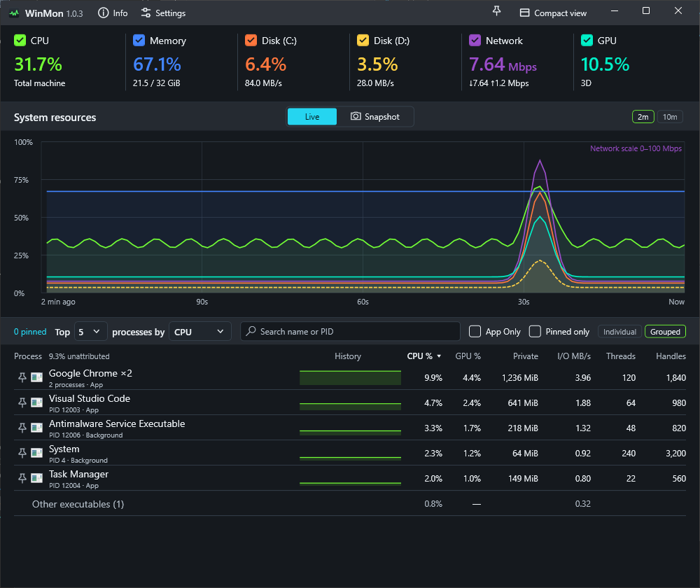
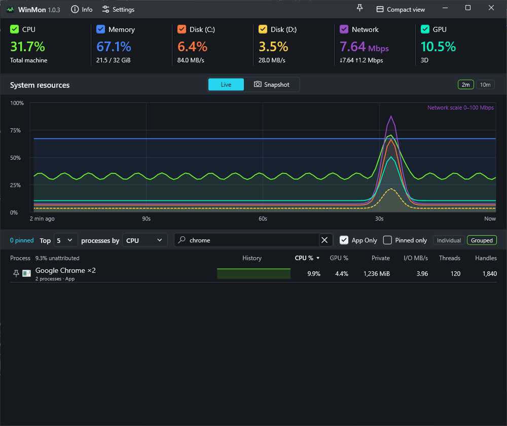
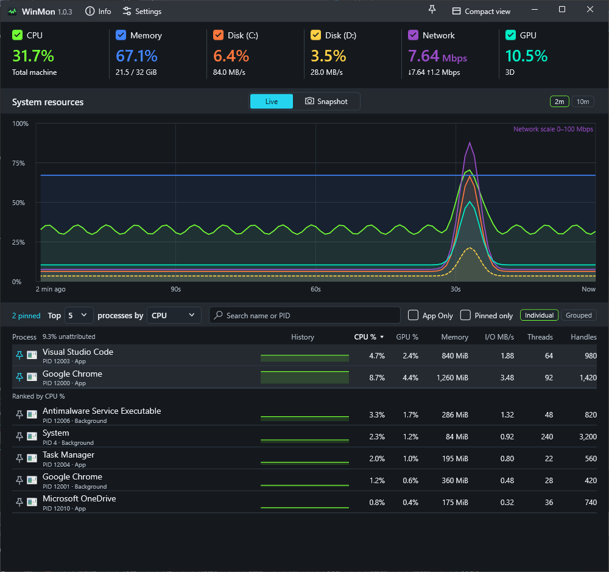
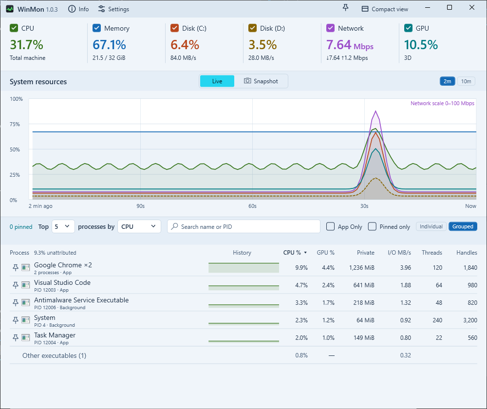

# WinMon

**See what your PC is doing. Find what's slowing it down.**

WinMon brings CPU, memory, disk, network and GPU activity into one clear Windows dashboard. Spot a spike, find the busiest processes, and look back at what was happening when it occurred—all from the same window.

**Windows x64 · Self-contained app · Portable settings · MIT licensed**

[Releases](https://github.com/galenblakeman/WinMon/releases) · [Get started](#get-started) · [Developer guide](docs/DEVELOPMENT.md) · [Privacy](docs/PRIVACY.md) · [Code signing policy](docs/CODE_SIGNING.md)


*Screenshots captured October 22, 2026 from the current source (version 1.0.3), using illustrative sample data. See the [example gallery](docs/example/README.md) for all views and capture instructions.*

## Your system, at a glance

Keep the whole picture in view while you work, play or troubleshoot. WinMon puts live resource readings above a shared timeline, so you can see how CPU spikes, disk activity and network transfers line up.

- **Watch the resources that matter.** Monitor CPU, physical memory, GPU, network throughput and up to two disk volumes. Hide individual chart traces to focus the view while recording continues.
- **Find the busiest processes.** Rank by CPU, GPU, memory, I/O, thread count or handle count, with application icons and history sparklines that follow your selected metric.
- **Look beyond the latest number.** Switch between 2, 10, 30 and 60-minute chart ranges, subject to your retained history, and inspect earlier samples.
- **Keep it close.** Pin WinMon above other windows, minimize it to the notification area, or bring it forward with a configurable shortcut.
- **Use less screen space.** Choose **Compact view** in the title bar for a horizontal strip with live readings and filled two-minute charts inside each resource box. **Full view** restores the dashboard and its size. The selected view is remembered when WinMon closes.


## See the app behind the processes

Browsers and other applications often spread their work across many processes. Switch to **Grouped** to bring processes from the same executable together and see their combined CPU, memory and I/O activity. Switch back to **Individual** when you need to investigate a specific process.



Grouped GPU shows the busiest member; grouped memory uses private bytes to avoid counting shared working-set pages repeatedly.

## Find the process you need

Search the ranked list by application name, executable name or PID. Turn on **App Only** to focus on processes observed with an application window, and use the **App** / **Background** labels to understand each row. In Grouped mode, an executable is an app when any current member has an app window.

The pinned count, ranking controls, search field, App Only and Pinned only filters, and grouping switches fit on one row at the minimum supported window width. Thread and handle counts show the latest observation at the selected moment; click either column heading to rank by it. Hover over a process name for its publisher metadata and executable path.

**Pin a process** using the pin beside its name or its row menu. Pinned rows stay above the rankings in pin order, with a cyan pin and a subtle background. They do not count toward the Top N limit or appear twice. **Pinned only** hides the ranked rows; search and App Only still filter both sections. Pins and the Pinned only filter are saved when WinMon closes and restored when it reopens. Individual processes and executable groups have separate pin lists. An individual pin follows one process lifetime, so an exited or restarted process stays marked exited and a reused PID cannot inherit it; executable-group pins match new instances of the same executable. Missing historical observations show “Not recorded at this sample”; gaps or uncertain observations show unavailable values.





See the [Pinned only example](docs/example/example_pinned_only.png) for a focused view of those processes.

## Catch the spike—even after it passes

Choose **Snapshot** in the centered **Live | Snapshot** switch above the chart to inspect the newest recorded sample, or click the chart to select an earlier moment. The snapshot shows resource readings for that interval, and the process table follows your selection so you can investigate what was busy then. Recording and the top readouts stay live while you explore.


Click **Snapshot** again to select the newest sample. Use **Left / Right** to step through samples, **Home** to jump to the oldest visible sample, and **Live**, **End**, **Escape** or **Return to live** to resume the live view.

**Copy snapshot** always copies the selected moment’s resource summary and displayed top process rows as plain text, preserving their sorting, grouping and filters. Reports include the timestamp and time zone, units, unavailable readings and averaging notes. Copying keeps the snapshot open; expired samples cannot be copied.

History is kept in memory for the current session, with configurable retention up to 60 minutes. Available history can be shorter on busy systems and is cleared when WinMon exits.

## Make it yours

Choose **Light**, **Dark** or **System** appearance, then pick a chart palette independently. Options include Classic, Ocean, Colorblind and high-contrast palettes, plus the new **Neon**, **Arcade** and **Tropical** choices. Palette names sort alphabetically in Settings; swatches and descriptions help you choose. Colors stay consistent across resource readings, chart traces and process sparklines.



<details>
<summary>Compare the new palettes and view Settings</summary>

| Neon | Arcade | Tropical |
| --- | --- | --- |
| [](docs/example/example_neon.png) | [](docs/example/example_arcade.png) | [](docs/example/example_tropical.png) |

The three custom palettes keep their supplied colors in both themes. Open an image for the full-size view.


</details>

Settings also let you choose disk volumes, history retention, startup at sign-in and notification-area behavior. The default show/hide shortcut is **Ctrl+Shift+M**.

Choose **Windows display language** or select English, Simplified Chinese, Russian, Spanish, Brazilian Portuguese, German, Japanese, French, Polish or Korean in Settings. Language changes apply when you save.

Need a hardware overview? **Info** brings together CPU, RAM, graphics adapters, physical drives, local volumes and network adapters. Expand the details or copy the report to share when troubleshooting.

## Light on your system

A monitor shouldn't become the thing slowing your PC down. WinMon samples once per second and reads every process in a single system query, without opening a handle to each one. When hidden or minimized, it keeps recording but skips drawing.

Measured over 11 minutes on a 12-thread desktop with about 1,250 running processes and a full 10-minute history:

| | Typical |
| --- | ---: |
| CPU | about 0.2–0.25% of the machine |
| Memory (working set) | about 145 MiB |
| Private memory | about 60 MiB |
| Startup to a ready window | about 0.6 s |

Longer history retention uses more memory. Your numbers will vary with process count and hardware; the [developer guide](docs/DEVELOPMENT.md#performance-tuning-measurements) explains how to measure them.

## Get started

Check the [releases page](https://github.com/galenblakeman/WinMon/releases) for published builds. Release packaging supports two ways to run WinMon:

| Option | How it works |
| --- | --- |
| **Installer** | Install for your Windows account, with a Start menu entry and an uninstaller. |
| **Portable ZIP** | Extract into a writable folder and run `WinMon.exe`. The included `portable.flag` keeps preferences beside the app. |

WinMon targets **Windows x64** and bundles its .NET runtime, so no separate .NET installation is required. Monitoring runs without administrator rights or a network service.

For a standalone executable, create an empty `portable.flag` beside `WinMon.exe` before launching to enable portable settings. Otherwise, preferences are saved in `%LOCALAPPDATA%\WinMon\settings.json`.

### Updates

WinMon checks GitHub for newer stable releases and offers **Update now** in the footer when a verified update is available. It downloads the update, saves preferences, exits, and restarts at the same location. Restarting clears the current monitoring history. Settings includes a manual check and an option to disable automatic checks.

In-app updates require a release signed with the update key already trusted by your copy of WinMon. Earlier copies without the updater require a manual upgrade. See [update setup and behavior](docs/UPDATING.md) for publishing and recovery details.

### Build from source

Development uses **.NET 10**, with SDK **10.0.402** pinned in [global.json](global.json).

```powershell
dotnet run --project src/WinMon/WinMon.csproj -c Release
```

To produce the self-contained executable:

```powershell
dotnet publish src/WinMon/WinMon.csproj -c Release -m:1 -p:UseSharedCompilation=false
```

The published app is at `src/WinMon/bin/Release/net10.0-windows/win-x64/publish/WinMon.exe`. See the [developer guide](docs/DEVELOPMENT.md) for tests, measurement details and diagnostics, or the [release guide](packaging/RELEASING.md) to build installer and portable packages.

## A few useful details

- Disk percentages show **active time**, rather than storage space used. Network throughput measures activity on the selected Ethernet/Wi-Fi adapter.
- GPU utilization reflects the busiest engine. Live GPU temperature and VRAM usage are outside this view.
- Unavailable readings appear as a dash and leave gaps in the chart. Very short-lived processes can exit between samples; process totals may not account for all system activity.
- Systems with multiple active processor groups are currently unsupported.
- To end a process, right-click a live **Individual** row and confirm **End process**. In **Grouped** mode, confirm the list to end all current processes in that group, including idle members. Processes started after confirmation opens are not included. Unsaved work can be lost; historical, system and WinMon rows cannot be terminated through this action.

## Open source

WinMon **1.0.3** is built with C# and WPF on .NET 10, and released under the [MIT License](LICENSE).

### Code signing policy

Starting with 1.0.3, the official executable and installer are signed and timestamped through Azure Artifact Signing with publisher Galen Blakeman. Earlier release assets remain unsigned. See the [Code signing policy](docs/CODE_SIGNING.md) for verification and release responsibilities and the [privacy policy](docs/PRIVACY.md) for local data handling.

Found a problem or have an idea? [Open an issue](https://github.com/galenblakeman/WinMon/issues).

Copyright © 2026 Galen Blakeman.
