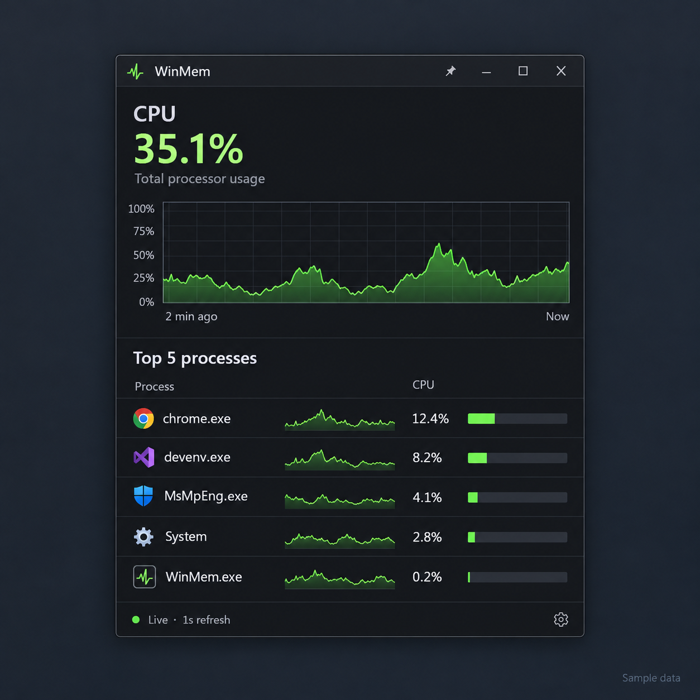
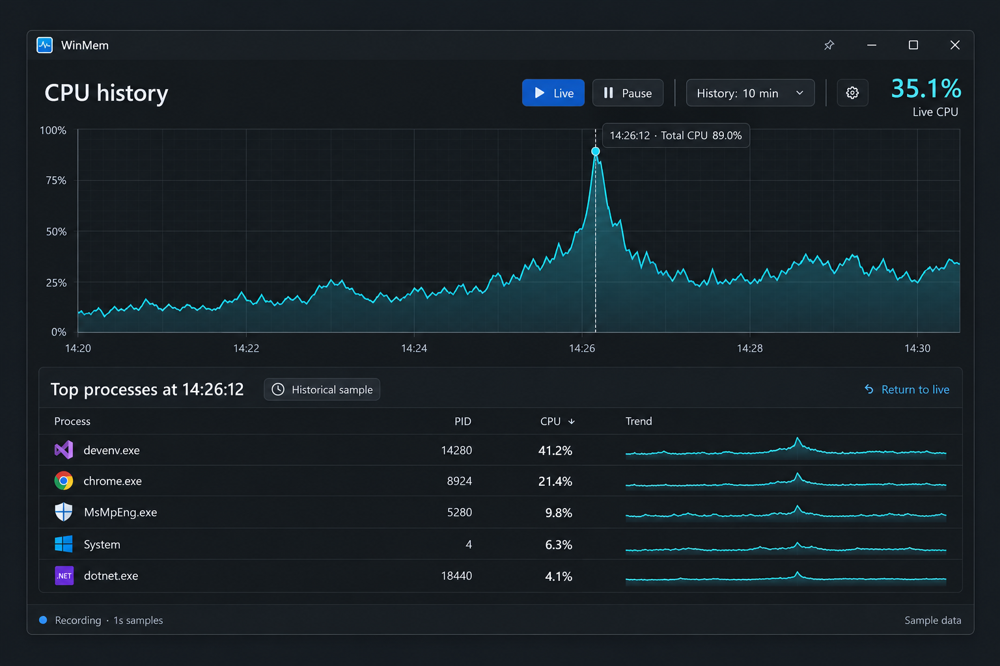
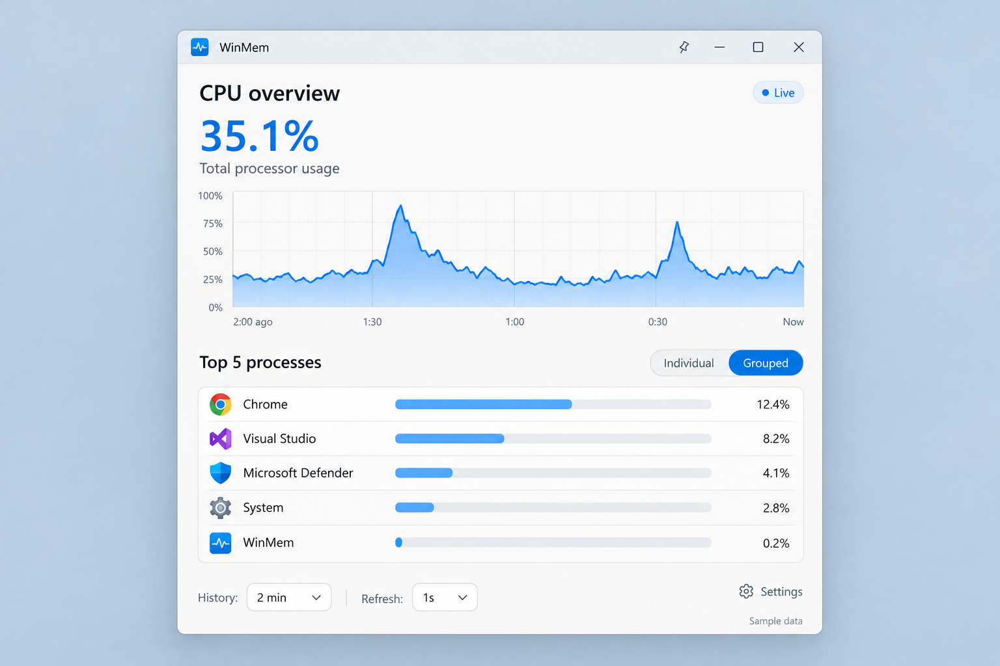

# WinMon CPU Monitor — Proposed Design

> Historical CPU-only design. The resource expansion selected on 2026-10-19 is implemented: [resource overlay and validation](RESOURCE-OVERLAY.md), [selected mockup](resource-overlay-selected.png).

Date: 2026-10-19
Status: WPF and concept A expanding into B selected; implementation authorized on 2026-10-19. See [implementation record](IMPLEMENTATION.md).

## Purpose

Build a focused Windows desktop utility that shows overall CPU usage and the five processes consuming the most CPU. Preserve the useful scrolling history of Process Explorer while reducing visual clutter.

“Top users” means CPU-consuming processes, not Windows user accounts. Despite the WinMon working name, this design covers CPU monitoring; memory monitoring is outside the initial scope.

## Decisions and current state

- Confirmed: standalone solution under `D:\Projects\WinMon`.
- Confirmed: overall CPU history and a top-five process display are the central product goals.
- Existing scaffold: `WinMon.sln`, `src/WinMon/WinMon.csproj`, .NET 10 WPF, SDK 10.0.402 with latest-patch roll-forward. The initial Release build passed; this is evidence about the scaffold only.
- Selected: WPF for the initial UI, with concept A as the compact default and concept B as the expandable investigation view.
- Initial implementation defaults: individual process ranking, one-second sampling, two-minute compact display, and ten-minute retention. Grouping is deferred. Distribution and broader environment validation remain separate release decisions.

## Visual concepts

The PNGs in this directory are AI-generated concept mockups created with the built-in image generation tool. All displayed values are illustrative sample data. They are visual references, not evidence of working features or pixel-perfect implementation specifications. Graph bar lengths and sample percentages must be made internally consistent in the actual application.

### A — Compact

A small floating dark window with green accents. Overall CPU percentage and a scrolling graph sit above five process rows. Each row includes a name, CPU percentage, and a small trend graph. A pin button controls always-on-top behavior; settings remain secondary.

Best suited to continuous, glanceable monitoring. Approximate initial window size: 440 × 580 device-independent units, subject to layout validation at common display scales.

### B — Investigate

A wider dark view with a large overall CPU graph. Selecting an earlier point displays the top five processes for that historical sample, including processes that have since exited. The selected timestamp and historical status remain conspicuous. Current live CPU remains separately labeled.

Best suited to answering “what caused that spike?” Approximate initial size: 1000 × 680 device-independent units, adapting to available monitor work area.

### C — Fluent

A light Windows 11-style alternative with blue accents, a prominent overall graph, and five process rows with usage bars. An Individual/Grouped toggle exposes aggregation explicitly.

This appearance is a visual direction, not a requirement to use WinUI. A comparable appearance can be designed in WPF, though framework controls and styling differ.

### Selected direction

Use A as the default and expand into B without opening a separate monitoring session. Keep the same collection pipeline and history when switching views. Treat C as an alternative visual direction. Provide accessible contrast and keyboard operation regardless of theme.

## Primary interactions

1. Launch into the compact live view. Show a brief collecting state until CPU deltas can be calculated; do not present the initial baseline as zero usage.
2. Update total CPU and the top five once per second by default.
3. Expand into the investigation view while retaining the existing history.
4. Hover over the graph to preview a timestamp; click to hold a historical selection for keyboard navigation and inspection.
5. Show the top five from that exact selected sample. Use a visible “Historical sample” label and timestamp.
6. Continue collecting while a historical point is selected. “Return to live” clears selection.
7. If the selected sample ages out, show an explicit history-expired state and offer Return to live. Never silently replace it with another timestamp.
8. Minimize to the tray when explicitly selected. Closing behavior and startup registration must be visible preferences; startup is opt-in.

Use one explicit Live/Pause recording control. Pausing freezes collection, labels the display as paused, and creates a visible gap when recording resumes. Reset sampling baselines on resume; do not spread an unobserved interval across the next sample.

## Display and sampling semantics

- Overall CPU uses a fixed 0–100% scale for total machine capacity. Clearly distinguish the latest live reading from any selected historical reading.
- Process CPU uses the same total-machine-capacity denominator. Do not display a one-core 100% value beside an overall-machine percentage without an explicit conversion.
- Rank on CPU consumed during the sampled interval, not cumulative lifetime CPU time. An optional smoothed ranking can be added later if clearly labeled.
- Collect overall CPU independently from the process ranking. The top five do not add up to overall CPU: other processes, kernel activity, measurement timing, and inaccessible data can account for differences.
- Use actual elapsed monotonic time for interval calculations. Timestamps support display; wall-clock adjustments must not distort usage.
- Key process history by PID plus process creation identity to avoid merging reused PIDs. Handle processes exiting during inspection without failing the sampling loop.
- New processes require a valid baseline or another verified source for interval attribution. Do not invent usage when a reliable delta is unavailable.
- An optional Grouped mode sums instances of the same executable identity. Display grouping explicitly; do not merge unrelated executables solely because their friendly names match. Define treatment of inaccessible executable identities during implementation.
- Exclude idle time from the ranked list. Show System activity where measurable. Do not force unattributed activity into a fabricated process row.
- With fewer than five measurable active processes, show the available rows and an explanatory empty state rather than invented entries.
- Access-denied or unavailable readings must be visibly distinguished from genuine zero usage. Default to normal user privileges; any elevation workflow is optional and must have a clear purpose.
- Sleep, resume, long scheduling delays, and paused recording create gaps or baseline resets, not misleading connecting lines.

The exact Windows collection API and treatment of large processor-group systems remain implementation decisions. Verify metric semantics, access rights, and supported machine configurations before committing to a provider.

## History model

Proposed defaults: a two-minute compact graph, a ten-minute in-memory recording window, and one-second samples. History duration controls should distinguish the visible time range from the retention limit.

Maintain bounded timestamped samples containing total CPU and the process attribution needed for historical inspection. Keeping only each sample’s top five supports historical ranking but cannot reliably produce complete per-process sparklines or retrospective grouped rankings. If those features are included, retain sufficient per-process interval data within explicit time and memory limits.

Prototype history storage and measure memory under heavy process churn before finalizing bounds. Historical entries retain safe display metadata after process exit. Do not store command lines, credentials, or unnecessary process details. Initial history is local, volatile, and cleared on exit; no telemetry or persistent recording is required.

## Architecture

Keep collection and history independent from the presentation framework.

- Collection: a Windows CPU provider obtains system and process observations and reports availability or sampling failures.
- Sampling coordinator: owns one cancellation-aware collection loop, baselines, timing, and pause/resume state. Prevent overlapping collection passes.
- History: bounded storage of immutable snapshots and process identity metadata, with coherent historical selection.
- Presentation: exposes live and selected samples, top-five rankings, grouping, and settings.
- UI: compact and expanded layouts share one session; custom graph rendering draws bounded data without creating an element per sample.

Start with logical boundaries inside the existing application project. Additional projects or dependencies require a concrete benefit; avoid splitting the solution merely to mirror this list.

On shutdown, cancel and await owned work, release process handles and other resources, and remove the tray icon. Recoverable sampling errors must not crash the application or create a tight retry loop. Present stale state and freshness when updates fail.

## WPF versus WinUI 3

WPF is the proposed starting point because this is a compact desktop utility with custom graphs, dense rows, and conventional window behavior. This is an engineering recommendation, not a measured performance claim.

WinUI 3 is a reasonable alternative when native Fluent controls and Windows design integration are higher priorities. It introduces Windows App SDK runtime deployment decisions. Unpackaged deployment is possible; MSIX is not mandatory.

Both frameworks can implement the proposed features. Neither determines CPU measurement accuracy. Measure startup, idle CPU, update overhead, memory, and responsiveness on the actual implementation rather than assuming a framework winner.

References consulted during the framework discussion:

- [WinUI 3 overview](https://learn.microsoft.com/windows/apps/winui/winui3/)
- [Windows App SDK unpackaged deployment](https://learn.microsoft.com/windows/apps/windows-app-sdk/deploy-unpackaged-apps)
- [WPF .NET 10 changes](https://learn.microsoft.com/dotnet/desktop/wpf/whats-new/net100)

The current project references .NET 10 WPF. No Windows App SDK package version has been selected. Recheck version-specific requirements if WinUI is chosen.

## Settings and accessibility

Proposed settings: theme, always-on-top, visible history range, retention limit, grouping, and startup behavior. Keep defaults useful and settings out of the main monitoring path. Begin with fixed one-second collection; offer faster intervals only after measuring overhead.

Remember window bounds, selected view, and explicit preferences. Restore off-screen windows onto an available monitor and respect display scaling. Use atomic settings writes and recover gracefully from invalid settings.

Support keyboard access to controls and historical selection, visible focus, accessible names, high contrast, readable numeric labels, and non-color indicators for live, paused, historical, and unavailable states. Validate resizing and 100%, 150%, and 200% display scaling.

## Delivery slices

1. Confirm framework and visual direction; establish layout and collection contracts.
2. Implement total CPU sampling and the compact overall graph with collecting, stale, paused, and unavailable states.
3. Add per-process deltas, identity handling, ranking, and five live process rows.
4. Add bounded history, historical selection, and expansion into the investigation view. Implement complete process trends only with adequate retained data.
5. Add tray behavior, settings persistence, window restoration, and theme/accessibility refinements.
6. Measure overhead, validate a representative Windows environment, and choose a distribution format.

## Verification and acceptance

- Unit-test interval calculations, normalization, top-five ordering, process churn, reused PIDs, unavailable observations, history eviction, cancellation, and pause/resume baseline reset with deterministic inputs.
- Verify historical inspection returns the ranking for the selected sample even after a process exits.
- If grouping is included, test grouping identity and historical consistency independently from individual ranking.
- Compare collection results with Windows tools over aligned intervals under controlled load. Document expected metric differences instead of promising exact Task Manager parity.
- Exercise normal-user access restrictions, sleep/resume, resize, monitor removal, DPI changes, and clean shutdown.
- Verify the total graph remains fixed at 0–100% and does not auto-scale small activity into apparent saturation.
- Measure monitor overhead and bounded memory over sustained runs and heavy process churn. Performance budgets remain to be agreed; no measured resource claims exist yet.
- Build the affected application and run focused tests. Record any unverified deployment or platform behavior separately from build evidence.

## Scope exclusions for the first version

No process termination, priority changes, driver installation, hardware temperatures, GPU/disk dashboards, remote monitoring, persistent trace export, or automatic startup without opt-in. The initial utility observes CPU activity and helps attribute spikes.

