# WinMon user guide

[Overview and download](../README.md) · [Screenshot gallery](example/README.md) · [Developer guide](DEVELOPMENT.md)

Detailed instructions for the desktop app and command-line monitor. Screenshots use illustrative data; see the gallery for capture version and provenance.

- [Install and run](#get-started)
- [Command line](#command-line)
- [Charts and gauges](#your-system-at-a-glance)
- [Processes](#see-the-app-behind-the-processes)
- [Services](#follow-windows-services-and-their-workers)
- [Connections and optional traffic monitoring](#see-which-apps-have-network-connections)
- [Session usage](#see-what-used-your-pc-this-session)
- [CSV export](#export-readings-as-csv)
- [History and automatic captures](#catch-the-spikeeven-after-it-passes)
- [Appearance and settings](#make-it-yours)
- [Updates](#updates)
- [Measurement limits and logs](#a-few-useful-details)

## Platform requirements

WinMon is distributed for Windows x64 and bundles .NET 10. The desktop installer's configured minimum is Windows 10 version 1607 (build 14393); the Store package manifest requires version 1809 (build 17763). These are packaging limits, not proof that every intervening Windows version has been tested. Use a Windows edition/version supported by [.NET 10's OS policy](https://github.com/dotnet/core/blob/main/release-notes/10.0/supported-os.md).

This documentation refresh was built and captured on Windows x64 build 26300.9818 with SDK 10.0.403 (the latest-patch roll-forward from the pinned 10.0.402 SDK). Older Windows releases, ARM emulation and installed Store behavior were not validated by these captures. Translucent system backdrops require Windows 11 build 22621 or later; other systems retain opaque theme colors.

## Get started

[Download the latest release](https://github.com/galenblakeman/WinMon/releases/latest), then choose how to run WinMon:

| Option | How it works |
| --- | --- |
| **Installer** | Install for your Windows account, with a Start menu entry and an uninstaller. |
| **Portable ZIP** | Extract into a writable folder and run `WinMon.exe`. The included `portable.flag` keeps preferences beside the app. |

WinMon targets **Windows x64** and bundles its .NET runtime, so no separate .NET installation is required. Ordinary monitoring runs without administrator rights or a network service.

For a standalone executable, create an empty `portable.flag` beside `WinMon.exe` before launching to enable portable settings. Otherwise, preferences are saved in `%LOCALAPPDATA%\WinMon\settings.json`. If that file cannot be read, WinMon starts with default settings and keeps the unreadable file as `settings.invalid.json` beside it. If that backup fails, saving defaults is blocked until the original can be preserved.

Developers can also create an [MSIX / Microsoft Store build](../packaging/msix/README.md) using the packaging tools. Store builds use Store-managed updates instead of the GitHub updater.

## Command line

WinMon releases include the Windows terminal app, `WinMon.Cli`, using Spectre.Console and System.CommandLine. It is bundled with the installer and desktop portable ZIP, and is also available as a CLI-only ZIP. The Microsoft Store package does not include it.

The installer offers an unchecked **Add WinMon.Cli to PATH for this user** option. Open a new terminal afterward and run `WinMon.Cli`; for ZIP downloads, run `.\WinMon.Cli.exe` from the extracted folder.

Running `WinMon.Cli` without arguments opens the interactive monitor with saved preferences, just like `WinMon.Cli watch`. Use `WinMon.Cli --help` for the command list; launch options still follow `watch`.

### Build from source

To build from source:

```powershell
dotnet publish src/WinMon.Cli/WinMon.Cli.csproj -c Release -m:1 -p:UseSharedCompilation=false
$cli = './src/WinMon.Cli/bin/Release/net10.0-windows/win-x64/publish/WinMon.Cli.exe'
& $cli
& $cli watch --grouped --apps-only --top 20
& $cli watch --tab services --sort memory
& $cli watch --tab connections
& $cli snapshot --sort memory --top 15
& $cli snapshot --filter chrome --format json
```

Release publishing defaults to a self-contained Windows x64 single executable, with embedded debug symbols and uncompressed assemblies, matching the desktop app. Only `WinMon.Cli.exe` is needed to run; dependency `.pdb` files in the publish folder are optional debugging symbols. The published app includes the .NET runtime; override the target with `-r` when publishing for another supported Windows architecture.

### Interactive monitor

`watch` is a read-only, keyboard-driven app with four tabs:

| Key | Tab | Sorting and filters |
| --- | --- | --- |
| **F1** | **Processes** | CPU, memory, GPU, I/O, threads and handles; executable grouping, text/PID search, App only, session pins and Top/All. Individual memory is working set; grouped memory sums private bytes. |
| **F2** | **Services** | CPU/private memory/I/O/name; search, all/running/stopped status and host/worker totals. Name sorting requires All. Details identify shared services, hosts and worker processes. |
| **F3** | **Connections** | Receive/send rates, received/sent totals and TCP/UDP counts; owner/PID/address/port search, App only, pins and traffic periods. Details list endpoint protocols, addresses, ports and TCP states. |
| **F4** | **Usage** | CPU time, cumulative I/O, GPU time, process lifetimes and last activity; search and App only. Share uses the same total-machine busy-time denominator as the desktop. |

Use **1–6** to sort; each sortable column heading shows its digit. Use **/** to edit the current tab's filter (Enter applies; Esc cancels or clears), **Up/Down/Page/Home/End** to select rows, and **Left/Right** to reveal additional columns. Numeric watch-table columns align to the right. The filter line appears only while a filter is being edited or is set. A column-navigation hint appears on the status line when columns are hidden. The first column takes the spare width, grouped processes show their member count (for example `×12`; Enter lists the PIDs), and the status line and key hints stay at the bottom of the terminal. The active tab has a `>` marker, including without color. The selected sort metric is brought into view automatically. **Enter** opens details; arrows/Page keys scroll, Left/Right pan long lines, and Esc returns. Each tab retains its own controls and selection.

**G** toggles process grouping, **A** App only, **T** cycles Top 5/10/15/20/50/All, **P** pins/unpins the selected application/service and **N** toggles Pinned only. Pins with a known executable path follow that executable across restarts, including its current PIDs in individual view; service pins use service names. Rows without a stable path remain session-only pins. A reused PID belonging to another executable cannot inherit a saved pin. In Services, **S** cycles status and **W** includes/excludes workers. In Connections, **R** cycles traffic periods: since start, 1 minute, 5 minutes and 30 minutes. **?** opens the full key guide.

Press **B** in any watch tab to enable or disable network traffic monitoring. The change is saved unless `--no-save` is active. Disabling releases only this CLI subscription; enabling connects to the installed service without installing or repairing it. Search-filter editing treats B as text.

**Space** freezes the displayed observations, including averaging windows, usage totals and health indicators, while collection continues. Press again to return to live data. Process and service CPU/I/O use the desktop's five-second window; GPU averages readable intervals and memory/counts use current observations. Usage remains cumulative rather than a five-second measurement. Startup, gaps, unavailable counters and partial traffic coverage are preserved. **Q** exits; **Ctrl+C** cancels. Both restore the terminal screen and cursor.

### Terminal layout and appearance

With at least 120 columns and 24 rows, the resource summary shows five panels in CPU, Memory, Disk, Network, GPU order. Titles, values, bars and histories share their resource color. CPU, memory, disk and GPU lead with percentages; Network leads with download speed and automatically scales to recent traffic. Below each bar: CPU clock in GHz, used/total RAM in GiB, disk throughput in MB/s, upload speed, and GPU memory or 3D. Histories cover 60 seconds, preserve gaps, and freeze with Space. The process table shows numeric metrics without a History column. Unavailable table values appear as a dash (—). The five-panel view ends at the boxes, leaving more process rows visible. Compact terminals with at least 24 rows show five lines in the same resource order, each with an aligned mini gauge and inline details: CPU clock, used/total RAM, disk read/write rates, download/upload rates and adapter name, and GPU memory or 3D. The 80x20 minimum keeps a numeric summary. Network uses download-rate units in every layout.

Interactive output uses UTF-8 so gauges and sparklines render as Unicode even when the shell starts with a legacy Windows code page. The CLI restores the original output encoding on exit; redirected output keeps its inherited encoding. Use a font with Unicode block characters, such as Cascadia Mono or Consolas.

The CLI header includes its build version (for example, `WinMon 4.1.0`). Keyboard shortcut hints and their brackets use bright cyan (`#00D8DB`), including sort digits and active-tab keys. Summary accents use orange CPU, blue memory, yellow disk, orchid network and turquoise GPU. The selected table row is highlighted across its full width. Values, gauge bars and resource histories share the corresponding color in every layout. `--no-color` and `NO_COLOR` keep the same readable text without resource colors.

Toggles show their state after the label (`[✓]`/`[ ]`, or `[x]`/`[ ]` without Unicode). The Memory history zooms to the range it covered in the last 60 seconds and its caption gives that range. A dark-blue highlight (`#264F78`) with light text marks the active tab and selected row; an arrow marks the active sort column. Enabled/live states are green (`#3FB950`), pins and paused/incomplete states gold (`#D29922`), and failures red (`#FF7B72`). Text labels, brackets, arrows and row markers preserve meaning with `--no-color` or `NO_COLOR`. Normal text/background use the terminal defaults; the accent palette targets dark terminals, and Spectre adapts colors to the terminal's supported color depth.

### Saved settings

Fresh CLI settings (including after `settings reset`) default to Top 10 on all four watch tabs. Existing saved row limits, including All (`0`), are preserved; `--top` overrides the active tab for one launch.

Interactive settings are saved separately from desktop settings in `%LOCALAPPDATA%\WinMon\cli-settings.json`: the last tab, per-tab sort/Top/App only/Pinned only, process grouping, Services status/Workers, Connections traffic period, network-monitoring preference and executable/service pins. Filters, selection, scrolling, details and pause are temporary. Keyboard changes save after a short debounce and on normal quit/Ctrl+C. Concurrent sessions merge changed controls instead of replacing each other's entire settings.

Explicit arguments override saved settings for that launch without saving those overrides. For example, `watch --tab connections --top 10 --network=false` temporarily changes the selected tab, its row limit and traffic subscription. Boolean options accept `--grouped=false` and `--apps-only=false`. Later keyboard changes save only the controls actually changed. An explicit finite Services limit falls back from a saved Name sort to CPU; explicitly requesting Name still requires All. `watch --no-save` loads preferences but does not save any interactive changes. `snapshot` remains independent of these preferences.

Use `settings show` to inspect saved settings, `settings reset` to restore defaults, and `settings set --network=true` or `--network=false` to change the saved traffic-monitoring preference. Saving this preference does not install or start a service; explicit `network install`/`network start` commands remain separate. Read/write failures show a warning while monitoring continues, and invalid JSON is preserved before replacement.

### Measurements and limits

Displayed memory uses the desktop's adaptive binary units (B, KiB, MiB, GiB, TiB). Table I/O and connection rates/totals use decimal byte units (B, KB, MB, GB, TB), and the network summary uses the desktop's adaptive KB/s–GB/s readout. Units appear beside each value in tables, details and text snapshots; for example, `2,048.0 MiB` becomes `2.0 GiB`, and small rates remain visible as `100 B/s`. JSON retains raw bytes/bytes per second and schema version 1.

The terminal requires ANSI support and at least 80 columns by 20 rows. Narrow layouts truncate rows and pan columns; all values and identities remain available through details. Use `--top 0` for All; finite startup limits may be 1–1000. All retains more process history and uses more memory. Resource/connection history is bounded to at most 30 minutes and the existing entry budgets, so requested traffic periods can have shorter coverage on busy systems. Service observations retain the existing two-minute window.

### Network traffic monitoring

Endpoint lists work without the optional traffic service. Network monitoring is enabled by default unless saved settings disable it. Use `--network=false` to disable it for one launch, or `settings set --network=true` to enable a previously disabled preference. Monitoring subscribes to an already-installed, authenticated local service and can start that installed service; it never installs, repairs or removes it. Outages retry every five seconds and a protocol mismatch requests an update. Missing or incomplete rates are not shown as zero. Without traffic collection, Connections falls back to TCP ordering while retaining the chosen sort preference.

Connections rows group the same executable's processes, matching the desktop. Traffic stays in Connections. Use `WinMon.Cli network start` to start and check an installed service. If it is missing, incompatible or not authorized for your account, explicitly run `WinMon.Cli network install` to install/repair, authorize the requesting account, start and verify it through the desktop's signed setup flow and administrator approval. Then run `WinMon.Cli watch --tab connections`. Setup requires a CLI build containing the signed service bundle; source builds without it explain how to enable monitoring through desktop WinMon. Store builds cannot run these service-management commands. Monitoring never triggers installation automatically, and setup does not save a desktop preference.

### Snapshots and scripting

`snapshot` takes a baseline, waits one second, then prints a table or JSON and exits. It supports the six process sorts, text/PID filtering and `--top 0` for All; it intentionally reports one measured interval. JSON uses raw bytes/bytes per second, explicit null readings and schema version 1. Use `--no-color` or `NO_COLOR` to suppress colors; redirected tables have no ANSI styling. Redirected `watch` output is rejected; use snapshots for scripts. Exit codes are 0 for a completed report/normal quit, 1 for failure, and 130 for cancellation; invalid arguments return a nonzero code.

The monitoring views do not terminate processes, change priority, control arbitrary services or create dumps. The explicit `network` commands manage only WinMon's network service. Process paths, publishers and endpoint details stay local unless you share the output.

## Your system, at a glance

Keep the whole picture in view while you work, play or troubleshoot. WinMon puts live resource readings above a shared timeline, so you can see how CPU spikes, disk activity and network transfers line up.

- **Watch the resources that matter.** Monitor CPU, physical memory, GPU, network throughput and up to two disk volumes. Hide individual chart traces to focus the view while recording continues.
- **Find network settings directly.** Settings → Network contains adapter selection, per-process monitoring and its service controls. Settings → Monitoring keeps history retention, the peak window and disk selection on a shorter page. Both pages share Save and Cancel.
- **Compare now with a recent spike.** In Full and Compact views, a gauge with each resource reading shows its current level; the dark line marks its highest reading over the peak window. Settings → Monitoring offers **1, 2, 5 or 10 minutes**, defaulting to **2 minutes**, independently of the chart range. Arc gauges show a small peak-marker icon and value beside the CPU, memory, disk and GPU names. These small labels always use native values: used RAM, disk throughput or GPU memory where available, taken at the moment utilization peaked; otherwise the percentage remains. The large current readings stay the same. Hover a gauge or peak label, or focus a resource with the keyboard, for the peak value, local time and age in the resource tooltip. Network shows its download peak with the same icon, using a compact rate such as **8MB/s**. Its tooltip gives the full rate and automatic gauge scale; both use the peak window. An unavailable reading leaves its gauge and corner label empty.
- **Choose chart resources.** Each chart type remembers its resource selections, time range and resource-control visibility between launches. Controls start collapsed until you open them for that type. Use the cog beside the chart selector to reveal the compact colored checkboxes centered above the chart and show or hide resources. The cog button beside the chart selector hides or restores these controls without changing the graph or your selections; each chart restores its own controls when you return, including after restart. The same legend serves Overlay, Small multiples, Heatmap and Focus, wraps at narrow widths, and hides with the chart. Logical processors needs no resource legend. Focus shares one configuration across its resource choices. Reset all chart preferences in Settings → Monitoring → Chart preferences; reset applies when you save Settings. Gauges stay live regardless of which chart resources are checked.
- **See why a tile changed.** Hover a resource tile, or focus its gauge, chart checkbox or compact box, for live CPU, memory, disk, network or GPU details.
- **Find the busiest processes.** Rank by CPU, GPU, memory, I/O, thread count or handle count, with application icons and history sparklines that follow your selected metric.
- **Look beyond the latest number.** Switch between 2, 10, 30 and 60-minute chart ranges, subject to your retained history, and inspect earlier samples.
- **Choose how history looks.** The chart header is labeled **Chart**. Hover the heading or chart dropdown for a guide to all five chart types, with bold headings and dividers separating each description. One chart dropdown offers the original overlaid traces, aligned small charts, a heatmap timeline, and Focus choices for each configured resource. The small charts, heatmap and Focus views fit their axis and resource labels into one narrow column beside the plot. Disk choices include their drive letters. Choosing a hidden Focus resource shows it again. WinMon remembers the selection. Chart clicks, Capture mode and automatic capture markers work in every view.

- **Inspect each logical processor.** Choose **Logical processors** in the chart dropdown for a CPU history graph per logical processor, each on its own 0–100% scale. The grid starts directly with the processor cells, without a processor-count or scale header. The CPU gauge and process percentages still measure the whole machine. Click any graph to inspect an interval; arrow keys and Capture work as usual. Selecting this view restores CPU if hidden. Short cells use compact sparklines, with exact values in their tooltips.

| Small multiples | Focus: Network |
| --- | --- |
| [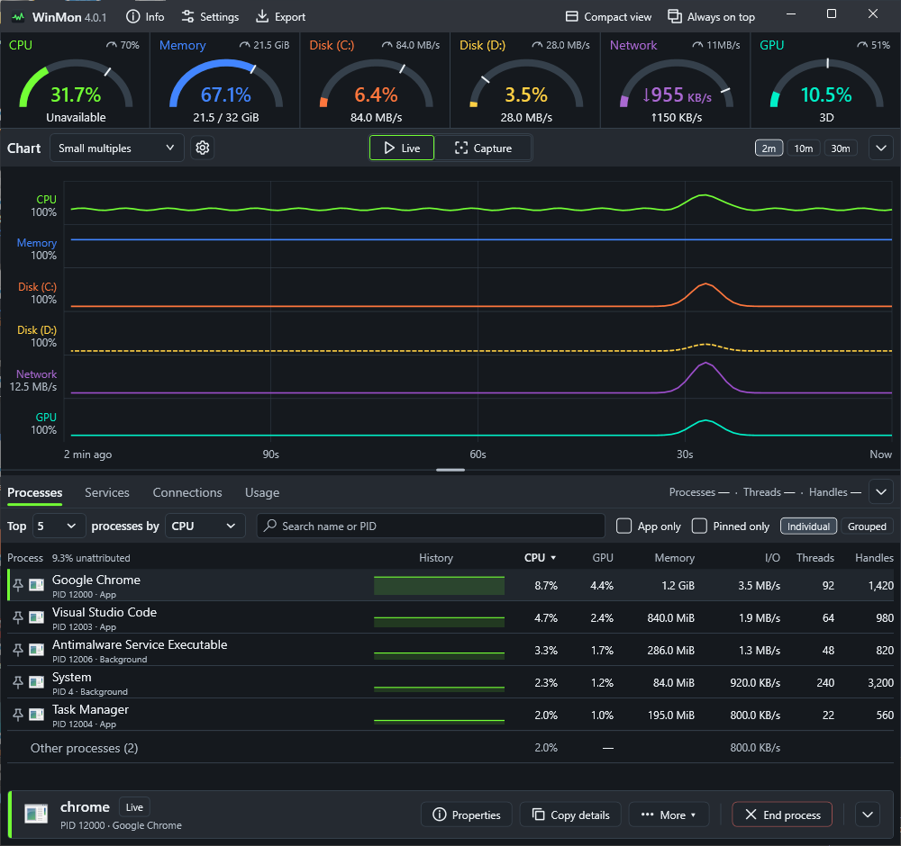](example/example_small_multiples.png) | [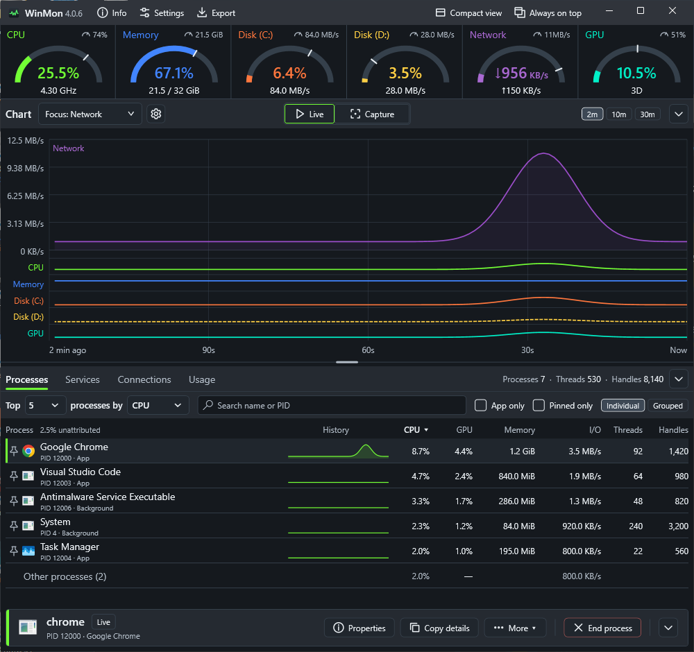](example/example_focus_network.png) |
- **Give either section more room.** Collapse the chart with the chevron at the right of its header, or collapse the activity panel with the chevron beside its tabs. Headers stay visible; use the same chevron to restore a section, change the chart type or period or click Live/Capture to open the chart, or click an activity tab to restore that panel. WinMon remembers both collapsed states and the previous chart/panel split across launches. Monitoring and Usage recording continue while collapsed.
- **Keep it close.** Enable **Always on top** in the title bar to keep WinMon above other windows, minimize it to the notification area, or bring it forward with a configurable shortcut. Its highlighted background shows when it is enabled.
- **Use less screen space.** Choose **Compact view** in the title bar for the same live resource gauges, colors, details and configured peak marks shown in Full view. Resource names are plain labels in both views; chart-series checkboxes live inside the chart. The selected gauge style, including **None**, applies to both views. **Full view** restores the dashboard and its size. Settings → General → **Startup view** can reopen the last used view (the default), or always start in Full or Compact view. You can still switch views during a session. Export is shown in the title bar only in Full view.

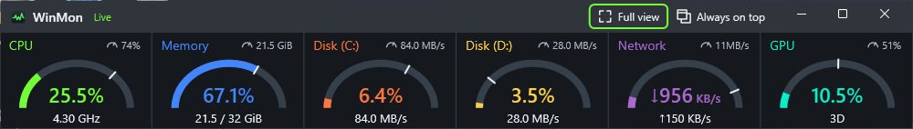

## See the app behind the processes

Browsers and other applications often spread their work across many processes. Switch to **Grouped** to bring processes from the same executable together and see their combined CPU, memory and I/O activity. Switch back to **Individual** when you need to investigate a specific process.

Grouped GPU shows the busiest member; grouped memory uses private bytes to avoid counting shared working-set pages repeatedly.

## Find the process you need

Search the ranked list by application name, executable name or PID. Turn on **App only** to focus on processes observed with an application window, and use the **App** / **Background** labels to understand each row. In Grouped mode, an executable is an app when any current member has an app window.

Click the **Threads** or **Handles** column heading to rank by that count. Hover over a process name for its publisher metadata and executable path.

Processes, Services and Usage keep units beside the numbers rather than in the column headings. Memory values automatically scale from B through KiB, MiB, GiB and TiB; I/O rates scale from B/s through KB/s, MB/s and larger units. Scaled values use one decimal place. The Services memory heading is **Memory**; its value is private memory. Usage shows **Share** as a percentage and I/O totals in adaptive byte units.

**Pin a process** using the pin beside its name or its row menu. Pinned rows stay above the rankings in pin order and do not count toward the Top N limit. Turn on **Pinned only** to focus on them. Pins and the Pinned only filter are saved when WinMon closes and restored when it reopens.

<details>
<summary>How pins behave across restarts and history</summary>

Individual processes and executable groups have separate pin lists. An individual pin follows one process lifetime, so an exited or restarted process stays marked exited and a reused PID cannot inherit it. Executable-group pins match new instances of the same executable.

Search and App only filter both pinned and ranked rows. Pinned processes do not appear twice. Missing historical observations show “Not recorded at this sample”; gaps or uncertain observations show unavailable values. Thread and handle counts show the latest observation at the selected moment.

</details>

See [grouped, filtered and pinned process views](example/README.md) in the example gallery.

**Properties** and **Copy details** include file and product versions from the executable metadata, or a missing reading when unavailable. Versions are cached by executable path and retained with captured history; they describe the file read on disk and may differ from a running image after an update.

Select a process row to use the accent action bar: **Properties**, **Copy details**, **More**, and **End process** (or **End group**). **More** includes **Open file location** and memory-dump creation for eligible live processes; exiting WinMon waits for a dump in progress to finish. More and the row menu also offer Show in Connections and Show in Usage. Navigation selects the same executable (or exact process lifetime for pathless connections), preserves the captured moment and disables unavailable destinations. It clears restrictive search/App only/Pinned only controls and changes Top to All only when needed to reveal the target. The same actions, plus pinning, remain available by right-clicking a row. Selection follows the process lifetime even when it falls out of the rankings or is filtered out; a reused PID cannot take over the selection. Group selections follow the executable, and switching between Individual and Grouped clears selection. Process termination retains its confirmation. Available actions depend on the selected process, Windows permissions, and whether you are inspecting history.

To make room, click the chevron at the end of the action bar. The bar slides away and leaves a slim strip with the selection's name; click **Show actions** to bring it back. Processes, Services, Usage and Connections share the choice, and WinMon remembers it.

Hover **Processes**, **Services**, **Usage** or **Connections** for a quick overview of that tab. Beside the activity tabs, the summary changes with the selected view. **Processes** shows the machine's process, thread and handle counts for the moment the table shows, live or captured. **Services** shows total services and how many are running at that moment. **Usage** shows total tracked app groups since the last reset and how many have a process running now. Counts of 100,000 or more are shortened, such as **152K**; hover for exact values. Unavailable service readings show a dash.

## Follow Windows services and their workers

Choose **Services** beside **Processes** to inspect local Windows services, including stopped services. Expand a service to see its hosting process and observed workers. CPU, private memory and read/write I/O totals follow the **Include worker processes** toggle; each metric row has a CPU history sparkline.

CPU and I/O values and rankings use the same five-second averaging window as Processes. Private memory uses the latest sample; sparklines show individual recorded intervals.

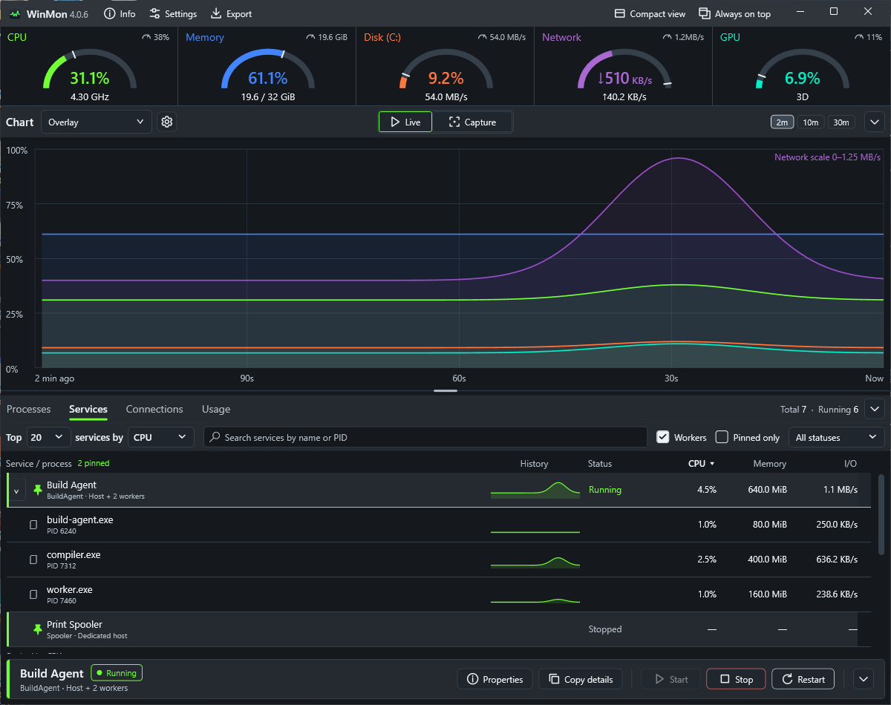

*Illustrative service identities and measurements, captured from the native WinMon window.*

Search by service name, display name, process name or PID, filter by status, and sort by CPU, memory, I/O or name when showing all services. Services sharing a host appear under one host total, with no separate resource attribution to each service. Worker relationships are inferred from observed process ancestry.

**Workers** and **Pinned only** follow the search box, ahead of the status filter. The pinned count appears beside the **Service / process** column heading. Use a service's pin button to keep its host group above the ranked list, without consuming a Top slot or duplicating the group. Pins follow service names through stops and restarts and are saved between launches. **Pinned only** hides unpinned groups; search and status filters still apply. A shared host's pin affects all its current services; expand it to pin or unpin an individual service. Process and worker rows keep their process icons. Pinned names absent from the selected live or captured frame remain saved but do not create placeholder rows.

The **Top … services by …** toolbar defaults to 20 service/host rows, with choices from 5 to 50 and **All**. Click a CPU, Memory, I/O or Name column header to change sorting; Name sorting is available with **All**. The dropdown and active-column arrow stay in sync. Search and status filters apply before the limit; expanded workers do not count against it. The search field grows with the window, and controls wrap below the ranking selectors when space is limited.

WinMon remembers the Services sort, status filter and **Workers** checkbox between launches, along with Top, pins and **Pinned only**. Search and expanded rows last for the current session. Name sorting requires **All**; choosing a Top limit switches it to CPU sorting.

The selected service stays in the action bar when ranking or filters hide its row. Its status and action targets continue to refresh, including after a host restart. Selecting another row changes the target; historical or unavailable data disables service controls.

The service action bar offers **Properties**, **Copy details**, **Start**, **Stop** and **Restart**. Properties opens a read-only detail window. Right-click a service or process row for **View process**, **Copy details**, **Start**, **Stop** and **Restart**. Right-click selects the row; the menu keeps its captured target if the rankings change. Shared-host and process rows disable individual service controls. Service controls use the same availability checks and confirmations as the action bar.

**View process** opens the corresponding PID in the process view. **Copy details** copies the selected service or process identity, status, observation time, resource metrics, and associated services/processes, including while inspecting history. Start, Stop and Restart operate on the selected service; Stop and Restart require confirmation, and Windows requests elevation when needed. Service controls are disabled while inspecting history. Service history retains up to two minutes, subject to a separate memory bound; older service captures are unavailable. Driver services are outside this view.

## See which apps have network connections

WinMon remembers the selected activity tab (Processes, Services, Usage or Connections) between launches, including when the activity panel is collapsed or the app starts in Compact view.

Choose **Connections** for an app-first view of TCP connections and UDP endpoints. Instances of the same executable share one row; processes with unavailable executable paths stay separate. Open **Properties** for the complete endpoint list. Choose **Top** and rank by **Receive/s**, **Send/s**, **TCP count**, **UDP count**, **Received** or **Sent**, or choose **All**. Pin apps to keep them above the ranked rows without using a Top slot. **Pinned only** and **App only** filter the list, and search matches names, PIDs and endpoints. Pins, ranking, Top and filters are remembered; search lasts for the current session. TCP and UDP endpoints are always included.

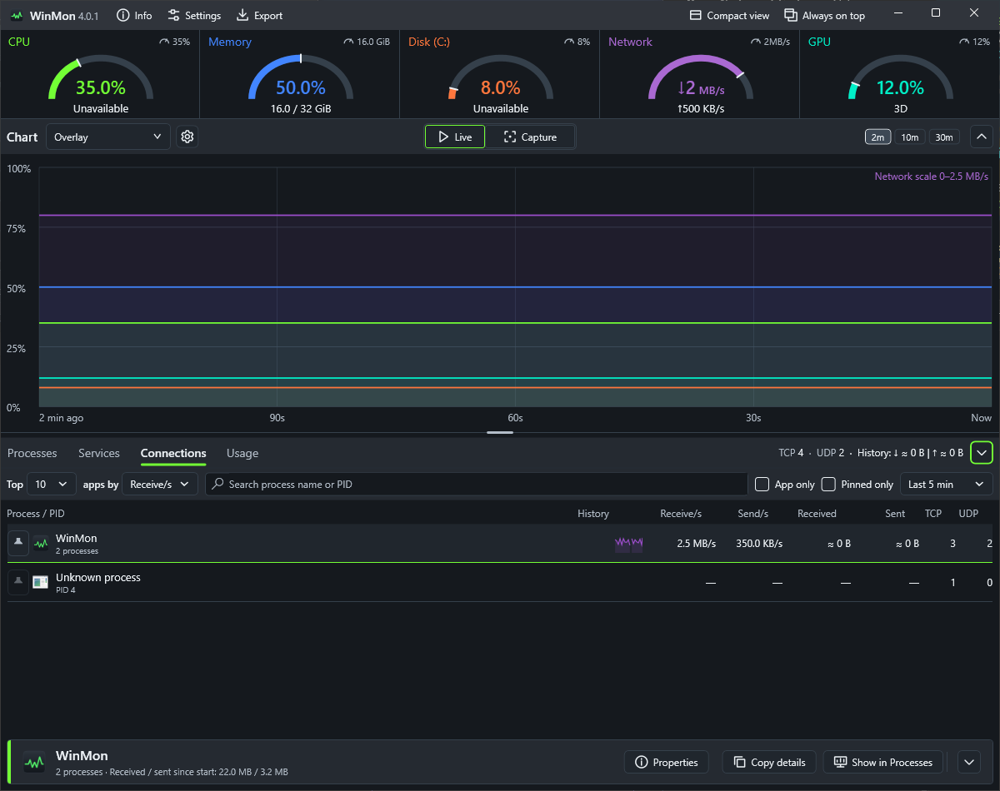

*Illustrative endpoints and traffic measurements; the example does not require installing the optional monitoring service.*

The main table shows app identity, separate receive/send rates when enabled, and TCP/UDP counts. The traffic-period dropdown sits at the end of the filter bar, after Pinned only, with abbreviated minute labels. Received and Sent sorts rank by bytes for that period, with unavailable totals last. Long app names are shortened with their full text available on hover. The action bar shows app identity and cumulative received/sent totals. Rates stay in the table; full traffic details remain in the summary tooltip, Properties and copied details. Connections remains available when traffic monitoring is off: traffic ranking is disabled with an explanation, and saved throughput choices temporarily display **TCP count** instead. The saved choice returns when monitoring is enabled. When monitoring is off in the live desktop view, a setup strip above the list explains app download/upload rates. Its **Enable monitoring…** button opens Settings → Network without enabling it automatically. The strip disappears when monitoring is enabled or viewing Capture history. Store builds omit it because the optional service is unsupported. Local and remote endpoints and their states are in Properties. The **TCP · UDP** totals beside the activity tabs describe all available endpoints at the displayed live or captured moment, independently of filters and Top. Available traffic summaries cover all observed processes and protocols, rather than the selected adapter or filtered rows. TCP/UDP counts and history byte totals share a single row beside the tabs, without live rates.

Select an app for **Properties**, **Copy details** or **Show in Processes**. Properties includes the local and remote endpoints, executable path, protocols, states and available traffic totals. A known executable group opens Grouped Processes; a row without an executable path opens its owning PID. Navigation preserves the selected live or captured moment and validates the process lifetime.

**Capture** shows the endpoints and app traffic recorded with the selected resource sample. Endpoint collection continues while other tabs are visible. Connection history stays in memory within the chart retention and a combined 100,000-entry budget for endpoints, owner metadata and traffic readings; it can therefore be shorter than resource history on busy systems. It is not saved across restarts. Samples without retained connection data show unavailable history instead of substituting live readings. Traffic rates retain their delayed measurement window; they are not instantaneous rates for the selected point.

Endpoint lists require no administrator rights, background service or driver. UDP shows local endpoints only; TCP listeners have no remote peer. Counts describe endpoints, not traffic volume. If Windows denies a table read, the view reports unavailable or partial readings rather than treating the failure as zero connections.

Optional **per-process network monitoring** adds received/sent rates and traffic-history sparklines to app rows, plus observed byte totals to selection and copied details. App traffic combines TCP and UDP across the executable's processes; rates describe the app rather than individual sockets. Network traffic rates throughout the gauges, charts, snapshots and Connections use decimal **KB/s, MB/s or GB/s**; adapter link speeds retain **Mbps/Gbps**. The tab summary shows **TCP · UDP · History: ↓ received | ↑ sent**, with the selected traffic period in its tooltip. The Connections totals tooltip explains that rates use a delayed, provisional five-second window, normally ending three seconds behind the current time; delivery delay can still make them incomplete. A lifetime's first observation establishes its byte baseline, so totals exclude counters already present at that observation. Known exited members retain their observed totals. Collection gaps keep totals visibly incomplete and suppress affected rates until a fresh window is available. Unavailable readings show dashes. Expired process-ID history rolls over without interrupting current traffic rates. Filtering does not reset totals; disabling/re-enabling or starting a new WinMon run does. Traffic history is retained with connection observations in memory; Connections CSV exports endpoints; Process network traffic exports observed lifetime counters and rates separately. See the setup instructions below for signed service setup and the [remaining native acceptance gates](design/PER-PROCESS-NETWORK-IMPLEMENTATION.md).

The traffic period offers **Last 1 min**, **Last 5 min** (default), **Last 30 min** and **Since start**. Received and Sent columns show observed bytes for that period; History plots combined receive/send traffic. Overall header totals ignore search, pins and Top. An ≈ prefix identifies incomplete coverage; hover for the recorded duration. Localhost endpoints are included. The period is remembered, and Capture ends the trace at the selected moment.

Signed desktop installers offer an unchecked **Install and enable per-process network monitoring** option. Selecting it runs service setup after WinMon is installed and enables monitoring for the installing user. A new service installation requires administrator approval. If approval is cancelled or setup fails, WinMon remains installed and you can retry in Settings → Network. The service remains separately removable.

Settings → Network also offers optional **per-process network monitoring** in signed desktop builds. Save the enabled setting to install an administrator-protected Windows service with one UAC approval. Compatible authorized installations are reused without UAC; later launches never prompt automatically. When startup or live collection is interrupted, WinMon retries the installed service every five seconds after disconnecting, without elevation. Recovery preserves observed session totals, marks gaps incomplete and waits for fresh rate readings; traffic missed during a gap cannot be recovered. An incompatible service version still needs **Repair**. Disabling releases this app's collection without elevation and leaves the shared service installed. **Repair** and **Remove network monitoring service…** are explicit maintenance actions which can require approval. Removal affects every user and is also available in Windows Installed apps as **WinMon Network Monitoring Service**, independently of a portable or per-user WinMon copy. Unsigned development builds cannot install it, and Microsoft Store builds do not offer it. Connections shows live process/executable rates and observed session totals when collection is available. See the [native acceptance checklist](design/PER-PROCESS-NETWORK-IMPLEMENTATION.md) for validation status.

## See what used your PC this session

Choose **Usage** beside **Processes** and **Services** to see each app's total **CPU time**, **I/O** and **GPU time** since WinMon started, including apps that have already exited. Rows group processes by executable, like **Grouped**, and show how many processes each app ran and when it was last active.

**Share** compares an app's CPU time with all the time the machine was busy. **Not attributed** at the bottom holds busy time WinMon could not assign to an app, such as processes that started and exited between samples. Rank by any column, search by name or path, turn on **App only**, and use **Copy usage** for a plain-text report. **Reset** starts the totals again from now.

Select an app for **Properties**, **Copy details** and **Open file location** in the action bar. Properties opens a read-only detail window. Right-click an app for **Show in Processes**: a running app opens live with its group selected, and an exited app opens Capture at the moment it was last active, while that moment is still in history. Live totals continue across in-app updates and are cleared when WinMon exits. In Capture mode, Usage instead sums complete recorded intervals over the chart-range duration ending at the selected sample. Its notice gives the actual start/end and identifies partial coverage. Copy usage, Properties and Usage CSV follow this period; period CSV adds until_utc and coverage_complete. Reset is available only in Live. Period observations have a separate 500,000-entry memory budget and start fresh after any restart, including an update; unavailable history is never replaced with session totals.

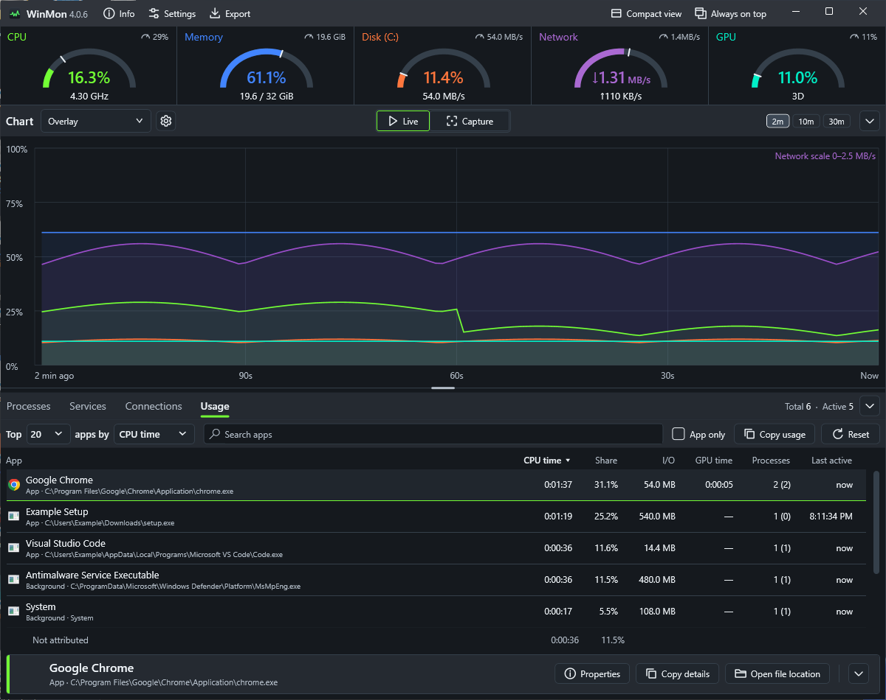

## Export readings as CSV

In Full view, choose **Export** (the tray-arrow icon) beside Settings in the title bar. The dialog starts with Processes, Services, Connections or Usage according to the active tab, and also offers resource history. Resource, process, service and connection exports can use all retained history or the current chart range. Live Usage totals cover the period since WinMon started or you last pressed Reset. While inspecting Capture, Usage exports cover the recorded period ending at the selected moment, using the chart-range duration. A normal Windows Save dialog lets you choose the destination.

CSV columns use stable English identifiers, UTC timestamps, invariant numbers and raw units such as bytes and bytes per second. Blank cells mean a reading was unavailable. Resource history includes gap rows. Process samples contain **retained observations**, not every process in every interval: WinMon omits many idle entries to limit memory, and their I/O includes files, network and devices. Usage totals include exited apps and a Not attributed row. Services export includes service names, numeric SCM states and host readings; shared services repeat host metrics, so do not sum those rows. Worker processes are excluded. Services history is limited to about two minutes and its observation budget. Connections export includes individual TCP/UDP endpoints and owners, regardless of the displayed grouping or filters, with availability flags for each address family. The separate Process network traffic export records one row per process lifetime per sample, including lifetimes without endpoints, with cumulative received/sent bytes, delayed receive/send rates and numeric ProcessNetworkQuality flags. Do not sum cumulative totals across samples. Unavailable rates are blank, and a missing traffic frame has an unavailable flag and blank counters. Both exports use bounded in-memory history. Empty or unavailable service/connection captures have a timestamp and availability flags with blank observation fields. Files are saved locally and may contain service names, network addresses, process names and executable paths; WinMon never uploads them. Export needs no administrator rights.

## Catch the spike—even after it passes

Choose **Capture** in the centered **Live | Capture** switch above the chart to inspect the newest recorded sample, or click the chart to select an earlier moment. The capture shows resource readings for that interval, and the process table follows your selection so you can investigate what was busy then. Recording and the top readouts stay live while you explore.

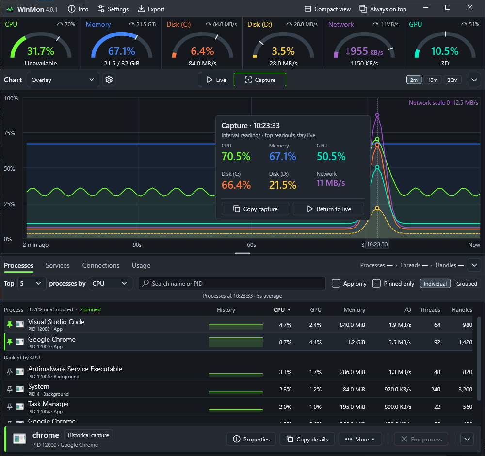

Click **Capture** again to select the newest sample. Use **Left / Right** to step through samples, **Home** to jump to the oldest visible sample, and **Live** (the play icon), **End**, **Escape** or **Return to live** to resume the live view. The Return to live button uses the same play icon.

**Copy capture** always copies the selected moment’s resource summary and displayed top process rows as plain text, preserving their sorting, grouping and filters. Reports include the timestamp and time zone, units, unavailable readings and averaging notes. Copying keeps the capture open; expired samples cannot be copied.

History defaults to 30 minutes for new installations, with configurable retention up to 60 minutes. Existing saved retention choices are preserved. Available history can be shorter on busy systems. By default it is cleared when WinMon exits, except across an in-app update. Turn on **Keep history across restarts** under Settings → Monitoring to save recent resource and process history on this device after a normal exit, including a Windows sign-out. Reopening WinMon restores only samples still within the selected retention period, even after a reboot. Usage totals and Service history start fresh. History is not guaranteed after a crash or forced shutdown. In Capture mode, a shared coverage line above the activity table shows the active view's actual retained span and whether the selected moment was recorded. Hover it for all four views' bounds, configured limits and restart behavior. A retained span can contain gaps; memory limits and unavailable selected observations remain explicit.

### Automatic captures

Choose **Automatic capture settings…** from the **Auto** menu to open Settings directly on **Automatic captures**.

Turn on **Automatic captures** in Settings to catch spikes while you are away. Each resource has a rule, such as **CPU above 90% for 10 s**, plus **Any one process** for a single runaway process, measured in percent of one core. When a rule holds, WinMon marks the moment with a triangle in that resource's color at the top of the chart and saves the Copy capture report for the peak as a text file. A rule waits for its cooldown, and for the value to drop clearly below the threshold, before it captures again.

The chart toolbar shows **Auto** immediately after the centered Capture control while capture rules are enabled and adds a number when captures are in history, such as **Auto 2**. Hover over the button for the full status and click it to open the captures menu.

Click a marker, or choose a capture from **Automatic captures** in the chart header, to open Capture mode at the peak; **Ctrl+Left** and **Ctrl+Right** step between captures. The capture card names the rule and offers **Open report**. Once a peak leaves history, its marker opens the saved report instead. Reports go to `%LOCALAPPDATA%\WinMon\Captures` (or a `Captures` folder beside a portable copy) unless you choose another folder; WinMon keeps the newest 200 and deletes only its own reports. Closing WinMon or restarting for an in-app update waits for report writes already in progress. Disk and network reports list processes by total I/O and say so, because Windows does not break process I/O down by drive or adapter. Network reports also list the top 20 executables by combined observed receive/send rate at the peak, when available, with delayed-window and incomplete-coverage notes. App traffic spans all adapters and protocols, so it need not match the selected-adapter trigger. Without traffic monitoring, the report explicitly says traffic is unavailable and retains the total-I/O fallback. A notification for each capture is optional.

## Make it yours

Choose System, Light, Dark or an additional appearance in Settings → Appearance, then pick a chart palette independently. Changing appearance selects its matching palette while you are using Classic or the previous appearance's matching palette; once you choose another palette, it stays selected through appearance changes.

The preview combines theme, palette and gauge style before you save. Palettes adapt their lightness for readable charts and labels. Colorblind, Signal, high-contrast, Copper and Gunmetal distinguish resources under simulated red-green and blue-yellow color blindness; Colorblind also uses distinct line patterns. See the gallery to compare Neon, Arcade and Tropical.

Candy and Porcelain offer warm light surfaces; Midnight, Evergreen and Wildberry offer darker colors. Copper and Gunmetal add a fine brushed finish. Additional translucent appearances are described below.
**Frost**, **Sapphire**, **Crystal**, **Slate** and **Prism** add translucent window finishes. Frost is light glass; Sapphire is deep blue glass. The title bar finish also fills the space beneath the native window buttons. Crystal uses bright cool edges, Slate has the strongest frosted panels, and Prism has a subtle blue-violet sheen. Charts and process data keep dark, readable surfaces. On Windows 11 build 22621 or later, WinMon uses the system Acrylic or Mica backdrop when available; elsewhere these themes keep their colors with opaque surfaces. Windows high contrast always uses system colors.

Choose how the resource gauges look under **Resource gauges** in Settings: **Bowl** (the default), **Needle**, **Segmented arc**, **Left bar**, **Bottom bar**, **Segmented bar** or **None**. A sample on the Appearance page combines the selected theme, chart palette and gauge style across all six resource colors before you save. Every style keeps the same height, so the chart doesn't move when you switch. **Bowl** and **Segmented arc** hold the reading inside a nearly round arc, with the detail line below. **Needle** draws a half-circle dial with the reading underneath; its detail line, such as clock speed or memory in use, appears when you hover the tile. Radial gauges sit below the resource name for clearer spacing. The full-view gauge row uses the window's full content width, with the same tile margins as Compact view. **None** hides the gauges.

See [Light appearance and additional palettes](example/README.md) in the example gallery.

<details>
<summary>Compare palettes and view Settings</summary>

| Neon | Arcade | Tropical |
| --- | --- | --- |
| [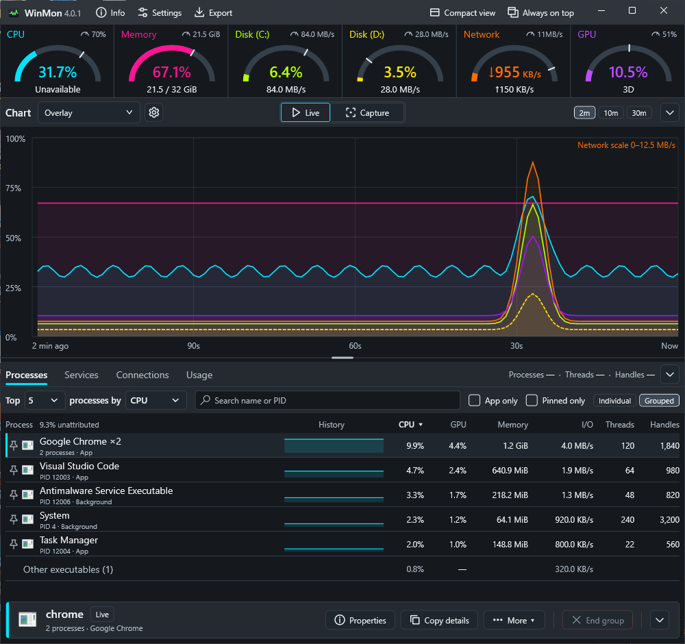](example/example_neon.png) | [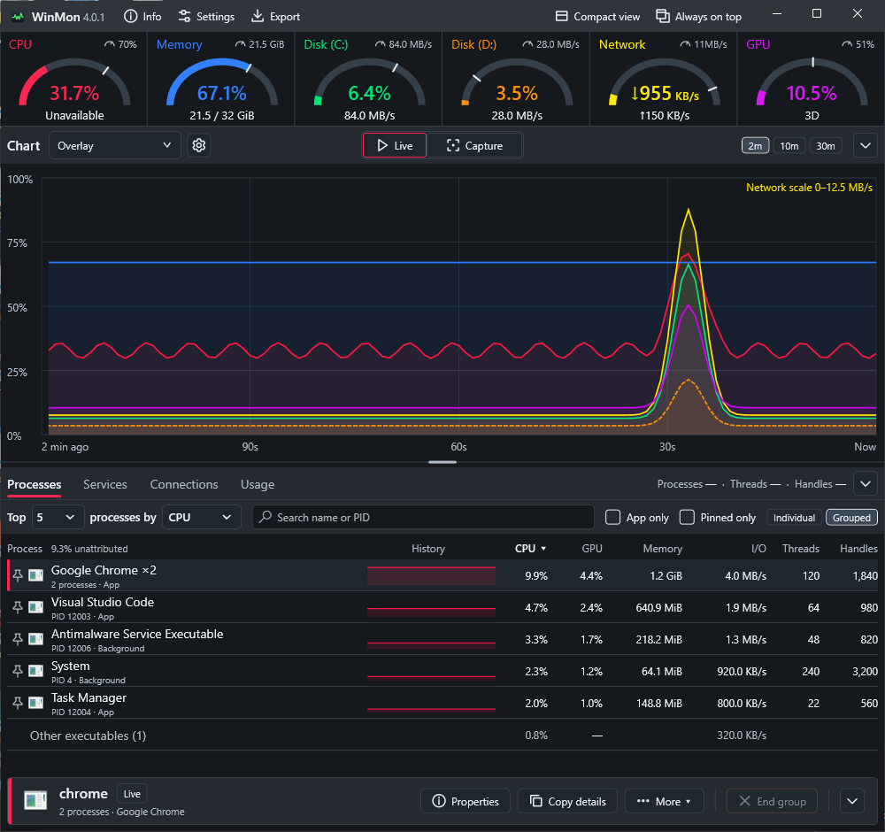](example/example_arcade.png) | [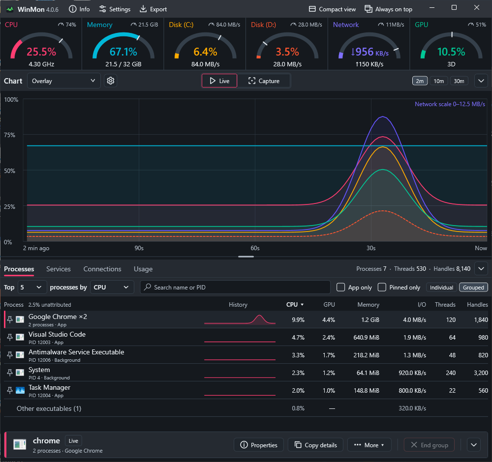](example/example_tropical.png) |

The three custom palettes retain their supplied hues; lightness changes where a theme needs more contrast. Open an image for the full-size view.

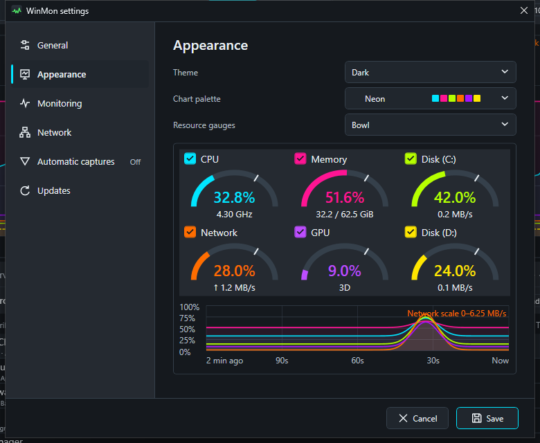

The Settings image above is from the installer/portable configuration. Store builds hide the GitHub update controls and use Store-managed updates. Their **Start WinMon when I sign in** uses the package's startup task, so WinMon also appears in Windows **Settings > Apps > Startup**. If you turn it off there, or a policy decides, WinMon's Settings say so and leave the change to Windows:

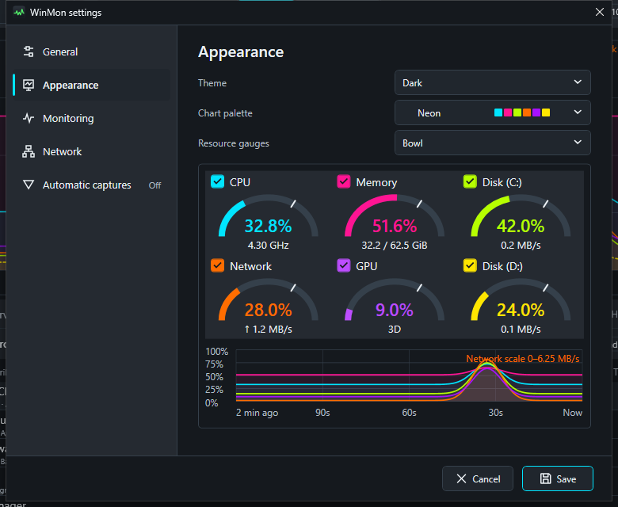

</details>

Settings is organized into **General**, **Appearance**, **Monitoring**, **Network** and **Automatic captures** sections in a sidebar, plus **Updates** in installer and portable builds, with one Save for all of them. Reopening Settings returns to the last section you viewed during this app session, even if you closed it without saving. Appearance holds the theme, chart palette and resource gauge style. General holds language, startup, notification-area behavior and the show/hide shortcut, which defaults to **Ctrl+Shift+M**.

After sleep or a display change, WinMon waits three seconds for monitors to reconnect before recovering its window position. It remembers the monitor chosen by dragging, resizing or Windows-key placement shortcuts during the current run. If that monitor stays disconnected, the window remains accessible on another display and returns when its monitor reconnects. Moving the window yourself chooses a new position.

Settings → Network → **Network interface** defaults to Automatic and shows the current adapter. Automatic switches to another connected adapter on the first sample after WinMon detects that its current one disconnected. You can choose a specific Ethernet or Wi-Fi interface, including one that is currently disconnected. A manual choice stays selected if that interface disconnects; its readings show as unavailable until it reconnects. Changing the choice starts fresh rate and total measurements.

Choose **Windows display language** or select English, Simplified Chinese, Russian, Spanish, Brazilian Portuguese, German, Japanese, French, Polish or Korean in Settings. Language changes apply when you save.

**Info** has three tabs: **Hardware**, **Guide**, and **About**. Hardware brings together CPU, motherboard, RAM, graphics adapters, physical drives, local volumes and network adapters in expandable sections. Collapsed headers show a short summary on the right; expand them for the full details. Refresh the snapshot or copy the complete report, including collapsed details, for troubleshooting. Guide provides expandable feature entries for charts and history, processes and pins, Services, Usage, Connections, captures and CSV export, automatic captures, and Compact view and shortcuts. Each entry explains its purpose with two numbered steps, shows the icon of the button a step names, and offers **Show me**, which closes Info and points out that feature in the main window. Charts and history includes a diagram of the chart toolbar and a selected moment. A CPU-spike walkthrough connects chart inspection, process rankings and Copy capture. Monitoring continues while Info is open.

About shows the installed version, copyright, MIT license and GitHub source link. Installer and portable builds share the existing update checker: **Check for updates** reports the result here, and **Update now** appears when an update is available. Updating closes Info and uses the main window’s existing download, cancel and restart flow. Microsoft Store builds show that updates are Store-managed and offer no GitHub update actions.

## Monitoring overhead

WinMon samples once per second and keeps recording while hidden or minimized, without drawing the dashboard. CPU and memory use depend on process count, retained history and enabled features. The November 9 profile of 4.0.6 averaged 0.25% of machine CPU and 162.5 MiB working set over 150 seconds on a 12-thread desktop, with history still filling and optional per-process network monitoring off. See the [performance history](PERFORMANCE-HISTORY.md#readme-refresh-profile-november-9-2026) for the conditions and the [developer guide](DEVELOPMENT.md#performance) to measure your own system.

## Updates

Installer and portable builds check GitHub for newer stable releases and offer **Update now** in the footer when a verified update is available. The footer stays at the bottom of the window however short it is, and keeps **Update now** after a cancelled or failed download so you can try again. **Update now** checks once more first, so it installs the newest release even if another was published after the offer appeared. The updater downloads the update, saves preferences, exits, and restarts at the same location. History recorded before the update is kept, so the chart and Capture mode continue after the restart; updating from 2.0.4 or earlier starts with empty history, because those versions do not save it. Settings includes a manual check and an option to disable automatic checks. Store builds disable these controls and use Store-managed updates.

In-app updates require a release signed with the update key already trusted by your copy of WinMon. Earlier copies without the updater require a manual upgrade. See [update setup and behavior](UPDATING.md) for publishing and recovery details.

## Build from source

See the [developer guide](DEVELOPMENT.md) for SDK requirements, build commands, tests and diagnostics, or the [release guide](../packaging/RELEASING.md) to create installer and portable packages.

## A few useful details

- Diagnostic logging is always on. App logs use `%PROGRAMDATA%\WinMon\Logs\App\<Windows SID>` when provisioned, with `%LOCALAPPDATA%\WinMon\Logs` as a fallback; service logs use `%PROGRAMDATA%\WinMon\Logs\Service`. Each active app set and the shared service set retain up to 10 MiB each. Open the current app folder from **Info → About → Open logs folder**. Repeated warnings and errors are summarized during operation and shutdown. Logs record errors, startup and connectivity changes without monitored process names or network endpoints, and are never uploaded automatically. Network summaries include coverage reasons and loss counts; service logs distinguish request failures and polling-rate rejections. An unreadable process discovered without observed traffic does not by itself mark traffic incomplete; actual coverage gaps remain flagged even after rates recover.

- Disk percentages show **active time**, rather than storage space used. Network throughput measures activity on the selected Ethernet/Wi-Fi adapter.
- GPU utilization reflects the busiest engine. Live GPU temperature and VRAM usage are outside this view.
- Unavailable readings appear as a dash and leave gaps in the chart. Very short-lived processes can exit between samples; process totals may not account for all system activity.
- Systems with multiple active processor groups are currently unsupported.
- To end a process, right-click a live **Individual** row and confirm **End process**. In **Grouped** mode, confirm the list to end all current processes in that group, including idle members. Processes started after confirmation opens are not included. Unsaved work can be lost; historical, system and WinMon rows cannot be terminated through this action.
