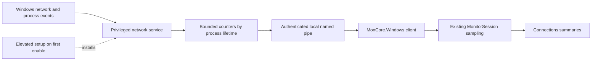

# Optional per-process network monitoring

Status: ETW prototype, service/authenticated IPC, signed setup code, Settings, Connections presentation and client-session accounting implemented. Signed native installation acceptance and final performance gates remain open. Written November 7, 2026 against WinMon 3.5.1, .NET 10 and SDK 10.0.402 as pinned in `global.json`. See the [implementation checklist](PER-PROCESS-NETWORK-IMPLEMENTATION.md) and [service implementation](../../src/WinMon.NetworkService/README.md).

## Goal and decisions

Add optional live per-process network throughput using Event Tracing for Windows (ETW) and a Windows service. The user approves administrator elevation when enabling the feature for the first time. WinMon continues to run unelevated, and subsequent launches use the installed service without another UAC prompt.

“One-time elevation” applies to initial provisioning and ordinary use. Repair, incompatible service upgrades, removal and authorization of another Windows account can require administrator approval. Organizational policy can prohibit installation or tracing; WinMon must explain the failure and keep normal monitoring usable.

| Area | Decision |
| --- | --- |
| Default | Disabled; ordinary monitoring installs no service |
| Initial channels | Installer and portable desktop builds |
| Store channel | Feature unavailable initially; no external installer or service bootstrap until packaged servicing and policy are validated |
| Privileged component | One machine-wide service, proposed name `WinMonNetworkMonitor`, installed separately from the per-user application |
| Service identity | LocalSystem for the initial kernel tracing implementation; justify and constrain this privilege in implementation review |
| Authorization | Explicitly provisioned Windows user SIDs; each client receives only traffic owned by its authenticated user |
| Collection | TCP and UDP, IPv4 and IPv6; process lifetime and network metadata events only |
| First presentation | Receive/s, Send/s and observed byte totals on Connections process/executable summaries |
| Retention | In-memory totals for the current client monitoring session; no saved network history |
| Installation location | Administrator-protected directory under Program Files, independent of the app location |

Existing IP Helper endpoint enumeration remains the source of current socket lists, addresses and TCP state. Endpoint counts remain distinct from traffic volume. Existing process I/O keeps its combined file/network/device meaning.

Excluded from the first increment: packet payload capture, DNS lookup, HTTP or TLS inspection, firewall rules, bandwidth limits, per-service attribution within a shared process, persistent usage accounting, historical charts, CSV schema changes and automatic privileged self-updates.

## Current code and integration boundary

`WindowsConnections.Capture()` in `src/MonCore.Windows/Monitoring/WindowsConnections.cs` reads IPv4/IPv6 owner-PID tables. Its portable `NetworkConnection` records contain no transfer counters. `MainWindow.Connections.cs` schedules collection only while Connections is visible. `WindowsResourceSampler` separately measures one adapter; process I/O counters cannot isolate network transfers.

ETW collection must continue while enabled and a client monitoring session exists, including when Connections is hidden, the activity body is collapsed, or WinMon is minimized to the tray. It must not inherit the endpoint tab's visibility gate. Closing WinMon ends its client session; another authorized client can keep the shared collector active.

Proposed ownership:

| Component | Responsibility |
| --- | --- |
| New `src/WinMon.NetworkService` project | Service host, ETW session, process ownership/lifetime tracking, bounded counters and authenticated local IPC |
| `MonCore.Windows` | Named-pipe client and Windows service status/start access; adapt snapshots to portable readings |
| `MonCore` | Portable process-network reading/status records and sampling integration; no service, IPC, ETW, WPF or native dependencies |
| `WindowsFrameSource` / `MonitorSession` | Read current cumulative service snapshots through existing sampling; calculate interval rates without a second UI sampling loop |
| `MainWindow` / `ConnectionsView` | Save preference, wire enable/disable actions and pass one presentation frame through `Update(...)` |
| Packaging tools | Signed service setup, protected deployment, repair, upgrade and removal |

Use the existing Windows process-lifetime identity convention. Do not create a second identity system or put byte counters on individual endpoint records. Preserve existing callers and constructors with an optional frame extension where practical. A minimal shared wire contract must not introduce a Windows dependency into MonCore. Choose the ETW decoding mechanism after the prototype; do not commit to a new dependency before measuring and checking compatibility.

## Enable, disable and remove

Place the toggle **Per-process network monitoring** in Settings with status text and an enable explanation. Proposed copy: “Show network send and receive rates for your processes. First-time setup installs a privileged Windows service and requires administrator approval. Later launches do not require approval. Service maintenance may require approval.” All shipping copy and accessibility names belong in English and all nine translated resource files.

1. On enable, inspect installed service identity, version, permissions and health without elevation. Reuse a compatible, authorized installation.
2. If provisioning is required, show the explanation and launch the signed setup component with UAC elevation. Capture the requesting user's identity through an authenticated handshake; the elevated administrator can be a different account. Do not provision the administrator's SID by mistake or trust a SID supplied in a command line.
3. Setup verifies its fixed service payload, deploys into the protected location, installs the service and authorizes the original user. Make installation transactional: a failure must not leave a partially authorized or executable service installation. Never replace an unrelated service with a colliding name.
4. WinMon connects, verifies the service and negotiates the protocol. Persist the enabled preference only after a successful authorized subscription; initial failures leave it disabled with an actionable message.
5. Future launches reconnect/start the compatible installed service without UAC. Later failures retain the user's preference but display unavailable readings and a manual repair action. Never trigger an unexpected startup elevation prompt.

Disabling saves the preference immediately and unsubscribes that client. No UAC is needed. It does not uninstall the machine-wide service, revoke another client's authorization, or stop collection needed by another subscriber. Re-enabling with a healthy authorized service requires no UAC and starts fresh client totals.

Provide **Remove network monitoring service…** separately. It requires elevation, explains the effect on all users, stops the owned ETW session and removes the service, protected binaries and authorization state. Preserve ordinary WinMon preferences and unrelated files. Other clients show service unavailable. Removing a per-user WinMon installation must not silently remove a shared machine-level component; document the independent removal route, including for portable users who delete their app folder.

## Service lifecycle and protocol

- Configure demand start. Give provisioned users only the SCM query/start rights necessary for ordinary reconnection, never service configuration, stop, delete or executable-write access. Installation persists across reboot; the first enabled client starts it again.
- Use a private, uniquely named system ETW session, not the legacy shared NT Kernel Logger. Enable only the needed network and process lifecycle events. Never stop or reconfigure another tool's trace session.
- First subscriber starts collection. Last disconnect stops it after a short bounded grace period; the service can then exit. Idle grace and reconnect behavior must not silently merge separate monitoring sessions.
- Use connection-bound subscriptions and bounded timeouts. Detect app crashes and broken pipes; no permanent subscription or tracing after the last client disappears.
- Handle shutdown, sleep/resume, service restart and trace restart explicitly. Each collector generation gets a new ID. Clients invalidate baselines on generation changes, sequence gaps, clock discontinuities or sampling gaps rather than computing spikes across them.
- Snapshots contain protocol version, collector generation, monotonic timestamp/frequency, sequence, cumulative loss/quality state, and per-process lifetime receive/send counters. Counters are cumulative within a generation; each client establishes its own baseline and observed totals.
- Operations are limited to status, subscribe, snapshot and unsubscribe. Set finite message sizes, row limits, client limits, timeouts and response cadence. Coalesce snapshots instead of queuing an unbounded backlog. Report truncation or capacity exhaustion as incomplete.
- Negotiate compatible protocol versions. An incompatible service produces “Network service update required” and unavailable metrics, while ordinary monitoring continues. Do not silently downgrade or accept unrecognized messages.

The initial UI delivery target is approximately once a second, subject to ETW buffer delivery. “Live” does not promise immediate delivery. Prototype repeats showed that even a two-second flush/drain can omit bytes which arrive later with no event loss. Production rates must account for event timestamps and delivery delay; a fresh IPC response alone does not establish a fresh traffic interval. Validate an explicit staleness/quality policy before presenting one-second rates. The prototype can wait for known workload byte targets; a general-purpose collector cannot use that test technique.

Keep event callbacks small: decode, validate and update counters; no UI dispatch, disk logging or executable/icon lookup per event.

## Privilege and privacy boundary

Kernel network tracing needs a privileged controller. LocalSystem is selected here because the documented kernel session path supports it; it is not a recommendation to run WinMon itself elevated. Before release, verify the exact modern system-session configuration on supported Windows versions and assess whether a narrower service identity can meet the same requirements.

- Authenticate each pipe connection using the actual Windows token, enforce an explicit SID allowlist, and reject remote clients. A SID, PID or executable path in a request is not authorization. Always check impersonation success and revert reliably.
- Resolve process ownership inside the service. Return only processes owned by the requesting user, across that user's sessions. Missing ownership or lifetime evidence means unattributed/unavailable data, never exposure of another user's process metadata. Existing endpoint enumeration may still list other users' processes with network metrics unavailable.
- Track process creation/exit events and reconcile an initial process snapshot. Attribute network events using their payload process identity, not blindly the ETW header's PID. Correlate event timestamps to lifetimes; ambiguous events are excluded and quality is reported. Never attach late events to a reused PID.
- Use explicit named-pipe and service ACLs. Prevent pipe-name impersonation and verify the connected server against the installed service process. Client authentication must not grant the server arbitrary file/process actions.
- Keep service executables, dependencies, setup state and configuration administrator-writable only. Use a fully qualified quoted service executable path. Never execute or load service code from the per-user installer directory, a portable folder, a network share or client-supplied path.
- Verify service package authenticity using the existing release trust model adapted to the separate component: trusted Authenticode publisher plus authenticated release metadata and expected hashes/version. Setup must revalidate the bytes it actually installs and avoid staging/path replacement races. A hash supplied by the unelevated caller alone is insufficient.
- The service exposes no arbitrary execution, file writing, packet capture, process control, installer or self-update command. Privileged setup/maintenance remains separate from the telemetry protocol.
- Keep only byte counters and identity/quality information needed for attribution. Do not retain packet contents, remote address histories or trace files. Diagnostic logs omit endpoint and traffic details by default.
- Bound client, live-process and recently exited lifetime state. Prune exited state after a documented bounded delivery grace period; counter eviction is marked incomplete, not silently treated as zero. Client totals retain accumulated bytes while per-process rows can expire.

An authorized user may write their own pipe client and use the granted telemetry access. Treat the authenticated user as the security boundary; checking that the caller is named WinMon is not a substitute for authorization.

## Measurement semantics

| Reading | Meaning |
| --- | --- |
| Receive/s and Send/s | Observed bytes in a five-second event-time window divided by five seconds; the window ends three seconds behind the current whole second and remains provisional |
| Received and Sent | Observed bytes since this client monitoring session established a baseline |
| Group totals | Sum of known member process lifetimes using existing case-insensitive executable grouping |
| First reading | Warming up until a complete delayed event-time window exists |
| Missing or failed collection | Unavailable, never zero or a stale live value |
| Event loss, ambiguous ownership or capacity limit | Incomplete interval and incomplete accumulated totals |

Count only the selected send/receive event families. Do not add TCP copy, connect, disconnect or retransmission events into the same byte totals. Validate retransmission inclusion, byte-size meaning and loopback behavior experimentally before documenting exact accounting semantics. TCP retransmission diagnostics and latency are deferred.

After a detected collection gap, suppress affected rate windows until a full fresh window exists; accumulated totals remain visibly incomplete. Healthy reconnects during the two-second grace can reuse the collector generation. Reconnecting after collector failure or resume starts a new generation. App integration establishes client-session byte baselines, avoids double-counting snapshots and retains incomplete totals for that client session. Each first-seen lifetime starts from its first received counter baseline; traffic before that baseline is not claimed. Start a new app monitoring session on a new WinMon run or explicit disable/re-enable. No lifetime-since-boot or pre-enable usage claim is permitted.

UDP includes traffic such as QUIC, but does not acquire a TCP state or a fabricated remote peer from this feature. Process identity does not identify a particular service inside a shared host. VPNs, proxies, virtual adapters and loopback can change where traffic is attributed; system-wide process sums need not equal the selected adapter chart. Verify representative cases and describe the results rather than promising equality.

## Connections presentation

Show Receive/s and Send/s on process/executable summary rows, with Received/Sent in selection details and copied details. Individual endpoints keep their existing columns; do not repeat a process total as though it belonged to every socket. Provide a selected owner's process summary in Individual mode. Rates must be labeled as owner/group totals, independent of endpoint protocol filtering; the initial feature does not promise a TCP/UDP traffic breakdown.

Keep the default table width usable and do not add network columns while disabled. Search and grouping follow existing behavior. Expanded endpoint rows remain socket details. Grouping changes never reset monitoring totals. No new throughput ranking selector is required for this increment.

Present distinct states: disabled, setup required, enabling, warming up, active, incomplete, service unavailable and incompatible. Use text and accessible names, not color alone. UAC cancellation returns focus to the enable control, leaves normal monitoring running and does not claim success. A historical resource chart retains the existing Connections live-only notice.

## Packaging and maintenance

The current Inno installer targets `%LOCALAPPDATA%\Programs\WinMon`; it must not become a privileged service executable location. Ship a separately signed service setup payload in desktop releases and keep normal app installation unelevated. Portable enablement explicitly installs a machine-level component and is no longer a zero-install operation for this optional feature.

Reuse signing and authenticated release verification from the current release tooling. Include the service/setup artifacts in release checksums and packaging validation. Do not extend the existing unelevated app updater into an unrestricted service updater.

Service updates are explicit elevated maintenance in the first increment. Keep a compatible protocol across routine app releases so most app updates require no service change. Setup stops collection, replaces protected files safely, restarts and checks health; on failure, restore the previous working version and report the interruption. Update or repair failure must preserve ordinary WinMon operation and other users' authorization.

Record a dedicated Apps & Features entry with repair/removal instructions. Protect machine-wide authorization data and support revoking a provisioned account through elevated maintenance. No reboot should be required during normal setup, but locked-file or policy failures must be reported rather than promising unconditional reboot-free installation.

Store builds omit enable/setup execution initially and explain that this optional feature is unavailable in that channel. Do not imply Microsoft Store approval from desktop validation.

## Delivery and verification

Implement in small verified increments; this document authorizes no installation on the developer's machine by itself.

1. Prototype collection in a disposable Windows environment. Validate TCP/UDP and IPv4/IPv6 PID attribution, existing and short-lived connections, exact byte semantics, loopback and trace permissions. Measure idle and high-event-rate cost and event loss before choosing the decoder/dependency.
2. Build the service, lifecycle tracking and portable counter/rate logic with deterministic tests. Exercise PID reuse, out-of-order/late events, duplicate snapshots, counter/generation resets, ownership failure, gaps, first samples, loss and bounded-state eviction.
3. Add authenticated IPC and protected setup. Test unauthenticated/remote clients, SID spoofing, malformed/oversized messages, pipe impersonation, another user's data, service-name collision and unauthorized file/service changes. Confirm failed authentication performs no privileged request.
4. Test setup cancellation, credential elevation under a different administrator account, first enable, reboot/relaunch without UAC, disable/re-enable, client crash, multiple clients/accounts, service failure, repair, compatible/incompatible upgrades, rollback and complete removal in a disposable VM. Verify collection stops after the last subscriber leaves.
5. Integrate Settings and Connections through existing view/update patterns. Add resource translations and focused UI tests. Run `./tools/Verify.ps1 -Smoke connections,search,feature,compact` and `./tools/Verify.ps1 -Store`; inspect the resulting PNGs in light/dark and narrow layouts. Add focused setup/status smoke coverage and include it in `docs/DEVELOPMENT.md`.
6. Compare the normal disabled build against the baseline, then active collection at idle, sustained throughput, many small transfers, process churn and multiple clients. Measure service CPU/private memory, allocation, IPC latency, event loss and UI cost. Record before/after results at the top of `docs/PERFORMANCE-HISTORY.md`. An unexplained regression blocks release; agree numerical service overhead budgets from prototype evidence before product integration.
7. Before shipping, update `README.md`, `docs/DEVELOPMENT.md`, packaging/release/update instructions and the privacy description with verified behavior and limitations. Extend release verification to build/test/sign the service and validate its installer lifecycle; update the solution/test entry points as required.

Release gates: ordinary enabled launches remain unelevated with no UAC; disabled operation has no tracing or new recurring IPC; cross-user telemetry is denied; traffic attribution and loss handling pass native tests; setup/maintenance are recoverable; performance has measured acceptance; Store builds retain normal behavior without service bootstrap.

## Evidence and unresolved validation

Repository evidence: [Connections](CONNECTIONS.md), [portable process identity](PORTABLE-PROCESS-IDENTITY.md), [shared monitoring](SHARED-MONITORING.md), [developer guide](../DEVELOPMENT.md), [desktop release packaging](../../packaging/RELEASING.md), and [MSIX packaging](../../packaging/msix/README.md).

Microsoft documentation:

- [ETW architecture, real-time consumption and event loss](https://learn.microsoft.com/en-us/windows/win32/etw/about-event-tracing)
- [TCP network events and attribution](https://learn.microsoft.com/en-us/windows/win32/etw/tcpip) and [UDP network events](https://learn.microsoft.com/en-us/windows/win32/etw/udpip)
- [StartTrace permissions and modern system logger restrictions](https://learn.microsoft.com/en-us/windows/win32/api/evntrace/nf-evntrace-starttracew)
- [Service access rights](https://learn.microsoft.com/en-us/windows/win32/services/service-security-and-access-rights)
- [Named-pipe client impersonation and failure handling](https://learn.microsoft.com/en-us/windows/win32/api/namedpipeapi/nf-namedpipeapi-impersonatenamedpipeclient)

These native APIs predate the repository's supported desktop Windows baseline, but that does not prove the proposed service configuration, event decoder or package works on every supported OS. Exact ETW settings, byte accounting, overhead budgets, secure setup mechanics and channel acceptance remain implementation/release gates. Permission statements describe documented behavior, not a successful local prototype.

## Outcome and departures

The isolated `tools/WinMon.NetworkProbe` prototype and its NUnit tests have landed. It exercises a private kernel ETW session against known TCP/UDP IPv4/IPv6 loopback workloads, validates worker PID and payload byte accounting, reports event loss and collector cost, and checks session cleanup. It is not referenced by shipping projects. Native results and remaining gates are recorded in the [implementation checklist](PER-PROCESS-NETWORK-IMPLEMENTATION.md).

The service/IPC increment now implements `WinMon.NetworkService`, portable snapshots and the `MonCore.Windows` client/protocol. It includes process-token ownership, retained lifetime attribution, delayed event-time windows, bounded queues/retention, loss reporting, authenticated local pipes, SCM server identity checks, connection-bound collection and unavailable-state handling. Deterministic/native pipe tests and the elevated collector experiment are recorded in the implementation checklist.

Signed setup code, Settings/preferences and release package integration are now implemented. The app reconnects without UAC when enabled, applies first-time setup only through explicit Settings Save/repair, and unsubscribes without elevation when disabled. Signed releases embed a standalone NativeAOT setup helper and RSA-signed service bundle before app signing; unsigned builds cannot provision. The helper authenticates the original requester's process/token, deploys only to a protected fixed location, provisions narrowly scoped service rights, rolls back pre-commit failures and provides independent all-user removal. CI run 42426234294 published the NativeAOT helper and signed both components with the existing release credentials; the downloaded bundle passed the production verifier locally. The corrected signed revision f455bc5 passed approved native installation, normal-user production identity/IPC, Settings disable/re-enable, enabled app restart, explicit signed repair and all-users removal. The original debug app was restored. An intermittent post-repair disconnect remains unexplained; second-account, reboot, crash/power-loss, supported-OS and installed-service performance acceptance remain open. Provisioned users receive only PROCESS_QUERY_LIMITED_INFORMATION on the service process so the existing held-process identity verification can succeed. Local signing/toolchain failures remain specific to the local build route. The user authorized this development box for native collector validation instead of the originally requested disposable environment. No product version is changed.

The implemented service keeps its idle listener alive after stopping collection, avoiding a shutdown/reconnect race; automatic service exit was optional in the design. Rates use delayed event-time buckets instead of arrival-counter deltas, because native repeats disproved a fixed two-second delivery assumption. A 65,536-item queue failed UDP burst validation; the bounded replacement holds 262,144 compact events (about 6 MiB), and native/queue loss are reported separately. The controller's transport loop preserves subscription/liveness and latest snapshots while all tabs are hidden; it does not compute rates or maintain a second UI history. MonitorSession applies client-session counter baselines, preserves observed totals across reconnects and rebases on collector changes without counting prior traffic. Connections shows owner/executable summaries and selected-owner totals; endpoint rows remain endpoint metadata. Functional tests and eleven Connections smoke renders pass; the UI performance comparison remains open. Managed failure rollback is implemented, but power-loss recovery, post-commit removal failures and installed-path performance still require native acceptance.

The design narrows the earlier broad monitoring discussion to the authorized user's process traffic and live Connections summaries. Persistent history, per-endpoint throughput, TCP diagnostics and Store service installation are deferred. Initial enablement is elevated once; subsequent service maintenance can still require elevation. Update this section with actual results and departures as implementation lands.
