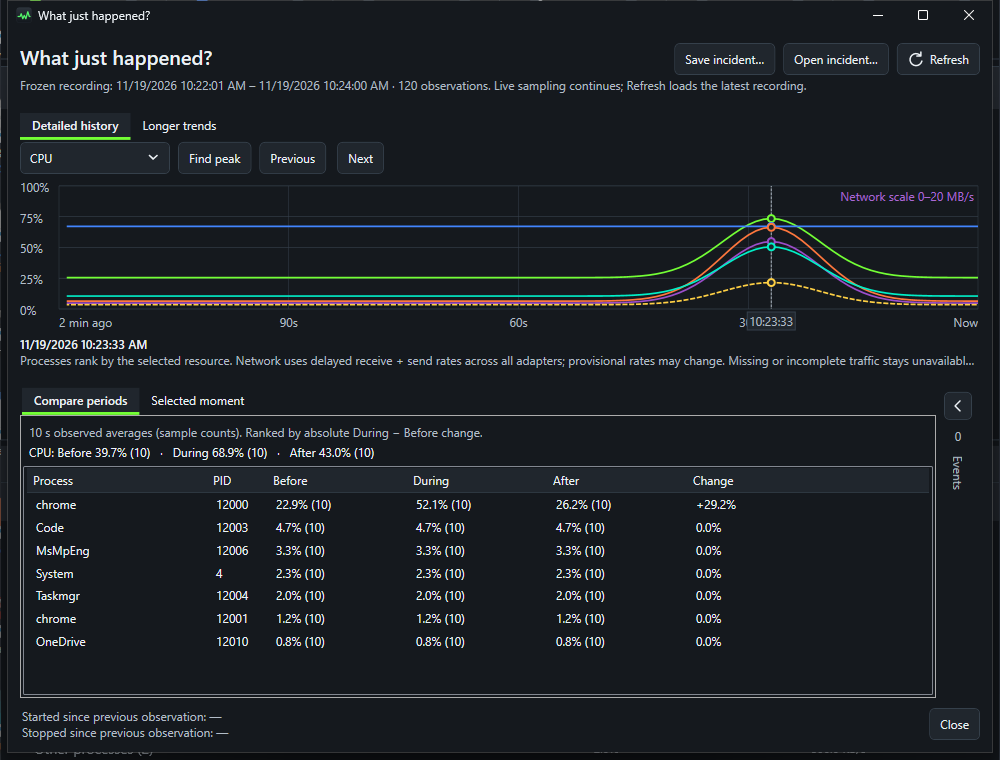

# README and screenshot examples

## Purpose

Make the repository introduction explain WinMon's value quickly and show realistic investigations with reproducible illustrative data.

## Scope

- Keep download instructions, a spike walkthrough, feature overview, customization and material limitations in the root README.
- Preserve detailed instructions in `docs/USER-GUIDE.md`, with network behavior in one section.
- Group clickable gallery previews by user task; keep capture instructions in `docs/example/REGENERATING.md`.
- Regenerate native-composed screenshots at the documented product version. Give the CPU spike a clearly busy app, accumulate traffic counters, and provide available example clock/network readings.
- Load installed app icons for illustrative process rows when available, without changing their synthetic identities or the live icon provider.
- Separate packaging OS minimums, .NET support policy and actual validation evidence. Record fresh whole-app profile results with their conditions.

## What landed

The root README now leads with download and historical investigation. The user guide retains advanced behavior, and the gallery provides task-based previews and a separate regeneration guide. Changes to sample data are limited to diagnostic paths; `ProcessRow.SetExampleIconAsync` lets example capture await icon loading without changing normal lookup behavior. The CPU recording and accumulated network totals have diagnostic assertions.

Validation: `Verify.ps1 -Smoke services,usage,connections` passed all six desktop test projects (1,355 tests) and three native smoke modes. `Verify.ps1 -Store` passed all six Store test projects (1,311 tests) on the final run. An earlier Store rollback test hit a temporary-file replacement error; both its focused suite retry and the complete rerun passed. Both ordinary and Store example captures completed, all 20 gallery images were visually inspected, local document links were checked, and a 150-second whole-app profile completed. NuGet vulnerability auditing was disabled for these commands because the configured audit endpoints were unreachable; compiler warnings remained errors. Explicit elevated/native acceptance experiments were not run.

No live monitoring, settings, service setup or release metadata behavior changed. Icon availability depends on locally installed executables; missing icons retain the existing fallback. The gallery still uses illustrative data, and captures do not establish older-Windows or installed-Store compatibility. Performance measurements are observational, not before/after claims about this documentation change.

## November 19, 2026 refresh

The README, user guide and gallery now show the History investigation window, including frozen recordings, resource peaks, Refresh and attribution limits. The example diagnostic opens History through the real dashboard button using the existing CPU-spike recording, then closes it before continuing the other captures. The illustrative recording date is November 19. Gallery provenance records WinMon 4.2.0 and Windows build 26300.9974; the older overhead measurement remains labeled with its original version and conditions.

Validation: `Verify.ps1 -Smoke capture,compact,snapshot,services,usage,connections` passed 2,001 desktop tests and all six smoke modes (252 renders); `Verify.ps1 -Store` passed 1,935 tests. Both builds and benchmarks completed with zero warnings/errors. Desktop and Store example capture completed, all 21 gallery images were visually inspected, and local file links were checked. NuGet vulnerability auditing was disabled only for the verification processes after both sandboxed and unrestricted attempts could not reach the configured feeds. No new performance profile, installed-Store validation or elevated service acceptance was performed; normal monitoring behavior is unchanged.

## Proposed task-first examples

Rename the gallery **WinMon examples** and open with a list of problems readers can jump to. Keep `docs/example/README.md` as the entry point and retain `#investigate` for the root README link. Start with the CPU investigation, then move through recording an incident, inspecting network and service activity, and accounting for usage. Finish with everyday monitoring tasks. Put **Appearance examples** in a collapsed section at the end and link there from the user guide's customization section. Keep the existing images and paths so documentation can continue to reference them directly.

Each example starts with a situation, gives two to four steps using actual control names, and ends with what the reader can learn or save. Put the steps before the image so the reader knows what to look for. Use one screenshot of the result by default. Add a second only when it shows a meaningful change, such as the result of including service workers. Keep steps and interpretations readable without opening the image. Put prerequisites and measurement limits beside the step they affect.

### First-pass lineup

| Reader's question | What to do and what to look for | Capture plan |
| --- | --- | --- |
| **What was busy during that CPU spike?** | Open **History**, select the CPU peak and use **Compare periods** to find the process whose readings changed around it. | Reuse `example_history.png`. Link to `example_snapshot.png` as a shorter route when the spike is still on the main chart. |
| **How do I catch the next spike while I'm away?** | Add an app CPU rule in **Settings → Automatic captures**, then open the saved `.wmincident` through **History → Open incident…** after the rule fires. | Start with steps and a user guide link. A later capture should show the reopened incident from a deterministic trigger. |
| **Which app was sending data, and where was it connected?** | Open **Connections**, sort by **Send/s**, and open the app's **Properties** for its endpoints. Explain the difference between the current rate and bytes sent over the selected traffic period. The optional desktop network service supplies app traffic rates and totals. Endpoint inspection is available without it. | Reuse `example_connections.png` for the ranking. Add a Properties capture later if the endpoint list needs illustration. |
| **Is the service host busy, or are its workers doing the work?** | In **Services**, expand the Build Agent row. Toggle **Workers** and compare the CPU shown in the parent row. Shared hosts report a combined total. | Reuse `example_services.png` for the expanded tree. Add a workers-off capture only if it makes the comparison easier to see. |
| **What used CPU even though the app has already closed?** | Open **Usage → Session**, sort by **CPU time**, and find Example Setup. Its row stays in the session totals after it exits. Explain the **Not attributed** row and show **Copy usage** as the way to keep the summary. | Reuse `example_usage.png` for session totals. Link to the guide for **Day** and **7 days**. |
| **How do I keep tabs on Chrome while I work?** | Use **Grouped** to combine Chrome's processes, search for Chrome and pin the group. Clear the search to show the group staying above the rankings, then use **Pinned only** when you want a short watch list. | Reuse `example_grouped.png` and `example_pinned_only.png` to show the two results. |
| **How do I keep live readings visible in less space?** | Switch to **Compact**, then expand the meter details for a reading such as disk latency. | Reuse `example_compact.png`. Keep the light and minimum-width examples with the appearance variants. |

Place chart choices where they answer a question. Put **Network Focus** beside the network walkthrough for comparing system download and upload over time. Mention that the selected adapter's system chart and the app's all-adapter traffic can differ. Link the other chart choices from the user guide. Link to **Longer trends** from the CPU example as the next step when the detailed spike has expired.

### Example as it would read

#### What was busy during that CPU spike?

1. In Full view, choose **History** in the title bar. It opens at the highest CPU reading in the retained recording.
2. Click the spike you saw on the timeline, then open **Compare periods**. Read the **Before**, **During**, and **After** columns for the top contributors.
3. In this recording, Chrome's CPU use rises around the selected moment and falls back afterward. To keep that part of the recording, choose **Save incident…** and select the time span.

Chrome is the first process to investigate. The readings show when it was busy and how much CPU it was using. Select **Selected moment** if you need the readings at the cursor.

### Rollout and acceptance

1. Rewrite the existing gallery and update its incoming link labels in the root README and user guide. Walk through each example against the controls and confirm every outcome described in an image is visible in that capture. Check local links and anchors and read the page at a narrow width. Preserve the capture date, version and build provenance for reused images.
2. Add captures only for outcomes the current images cannot show. Start with opening an automatically saved incident. Use the diagnostic fixtures and existing smoke modes. Review the completed native-window captures and record provenance by image or capture group if old and new images coexist. [Capture and review instructions](../example/REGENERATING.md).

This follow-up is a design proposal. Gallery edits and new captures are pending.
