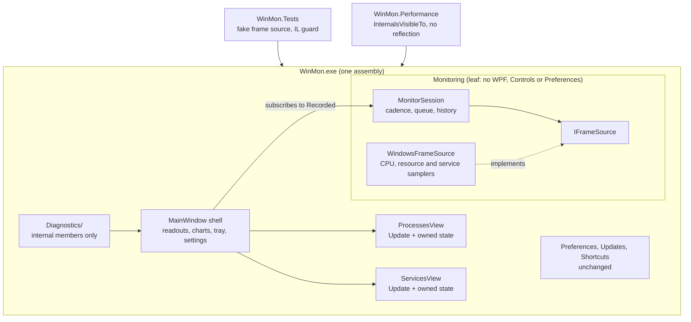

# Code structure

Agreed on 2026-10-24 after a design review of the 2.0.4 code. Status: in progress; see Sequence for the steps that have landed.

## Why

New features and performance work both land in `MainWindow`, which is about 4,900 lines across 12 partial files. It owns the sampling loop (`CollectAsync`, `Deliver`, `DrainPendingSamples`), the process list, and roughly 2,200 lines of smoke and example diagnostics that read its private fields. `tools/WinMon.Performance` reaches the same private fields and methods by reflection, so renaming a field breaks the benchmark at run time instead of at compile time.

The goals are:

- add the next view (for example Startup apps or Network connections) without growing `MainWindow`;
- drive sampling, history and refresh from tests and the benchmark without reflection.

Preparing for a second front-end (tray-only, CLI export) is not a goal. If one becomes a goal later, revisit the single-assembly decision below.

## Target

## Decisions

| Area | Decision |
| --- | --- |
| Assembly | Stay one assembly. A guard test enforces the `Monitoring` rule instead of a project boundary. |
| `Monitoring` layering | Leaf namespace: no references to WPF, `WinMon.Controls` or `WinMon.Preferences`. The two back-references were removed by moving types down: `RateText` moved from `Controls` to `Monitoring`, and `Preferences.ProcessPinPreference` became `Monitoring.SavedProcessPin`, which `MonitorPreferences` stores. Type names are not serialized, so the settings file is unchanged. |
| Guard test | `MonitoringLayerTests` reads every `WinMon.Monitoring` type's base type, interfaces, field and method signatures, and the tokens in its method bodies. It fails on any type from a WPF or Windows Forms assembly, or from a WinMon namespace other than `Monitoring` and `Resources` (the localized strings). A source-text scan would miss fully qualified names and the `global using` directives in `GlobalUsings.cs`. |
| Names | `CpuSample` → `MonitorSample`, `CpuHistory` → `MonitorHistory`. `CpuSnapshot`, `ICpuSnapshotProvider`, `WindowsCpuSampler`, `SystemCpuTimes` and `ProcessCpuTimes` keep their names because they are CPU timing only. |
| Sampling | `MonitorSession` in `Monitoring` owns the 1-second `PeriodicTimer` loop, the pending queue and its drain, retention compaction, `MonitorHistory`, service history, `Latest`, `LatestFull` and `Error`. Surface: `Start(ct)`; a `Func<SamplingOptions>` read once per tick; a `Recorded` event after each drain; `Record(sample, full, services)` to add a synthetic frame without the loop. |
| UI thread | The session takes an `Action<Action> post`. The window passes `a => Dispatcher.BeginInvoke(a, DispatcherPriority.Background)`, which keeps today's drain priority. Tests and the benchmark pass `a => a()`. `Monitoring` does not reference `Dispatcher` or `SynchronizationContext`. |
| Collection | The session collects through `IFrameSource` (`Capture(SamplingOptions)`, `Reset()`). `WindowsFrameSource` combines `WindowsCpuSampler`, `WindowsResourceSampler`, `WindowsServices.Reader` and `ServiceTree`, and handles the per-sampler fallbacks (CPU unavailable, services unavailable). The session keeps the catch-all `ReadingsUnavailable` path. |
| Sampling options | Each capture reads one `SamplingOptions` (drives, retention predicate, retain-all), built from a single `Volatile.Read` of the immutable `MonitorPreferences` plus the published retention predicate, so drives and retain-all always come from the same moment. The plan was for the window to rebuild the options only when they change; per-tick building replaced it because diagnostics swap `_preferences` directly and a missed rebuild site would silently sample the wrong drive. |
| Views | A view is a XAML UserControl updated through one `Update(...)` call, as `ServicesView` already is. `ProcessesView` takes the header, search, filters, sort headers, ranked and pinned rows, action bar, pins, selection and process actions out of `MainWindow`, including the `ProcessActions` and `ProcessPins` partials. |
| View state | Each view takes an immutable state record at construction (`ProcessViewState`: sort, grouping, top count, apps-only, pinned-only, pins; the Services equivalent: status filter, sort, worker toggle) and raises `StateChanged`. `ExitPreferences` writes `view.State` back into `MonitorPreferences`. The settings file format does not change. |
| Sampling error | The window keeps `_samplingError` as presentation state, copied from `Session.Error` on each `Recorded`, because diagnostics set it directly to check error rendering. |
| Shell | `MainWindow` keeps the title bar, resource readouts and charts, range chips, compact mode, snapshot copying, tray, global shortcut, settings, theme, language, updates and closing. It subscribes to `Recorded` and keeps the update-ready signal. |
| UI style | XAML for layout and window chrome. Code-built elements only for rows updated every tick, such as `ProcessRow : Grid` with its custom automation peer. |
| Diagnostics | Stay in the shipping exe, because smoke tests the real published binary. Move the `*.Diagnostics.cs` and `Examples.cs` partials into a `Diagnostics/` folder of classes that take a `MainWindow`. They use only internal members: `window.Session`, `window.Processes`, `window.Services`, and about 10–15 named controls on the window. A diagnostic that needs more gets a new named internal member, never reflection. |
| Benchmark | `InternalsVisibleTo("WinMon.Performance")`. The benchmark drives the session's `Record` and an internal refresh method instead of private names. The `Application.IsShuttingDown` startup workaround stays, behind one commented helper, because it reaches into WPF rather than WinMon. |
| Performance | Each step records `WinMon.Performance` results before and after on the same machine, in the developer guide's performance section. A measurable regression in any scenario (live, historical, grouped, Services, compact, pinned/selected) blocks the step until it is explained or fixed. |
| Release | No version bump and no separate release. The commits ship with the next feature release. |

## Sequence

Regular commits on `main`, one per step, each built and tested on its own:

1. Done: make `Monitoring` a leaf: fix the two back-references and add the IL guard test.
2. Done: rename `CpuSample` and `CpuHistory`.
3. Done: add `MonitorSession`, `IFrameSource` and `WindowsFrameSource`, with session tests using a fake source (gaps, error and recovery, drain order, no drain after close).
4. Move `WinMon.Performance` from reflection to `InternalsVisibleTo`.
5. Move diagnostics and examples into `Diagnostics/`.
6. Extract `ProcessesView` and the view state records.
7. Update the developer guide's code structure section with what landed.

Steps 1 and 2 are independent. Step 3 depends on both, steps 4 and 5 depend on step 3, and step 6 depends on step 5.
