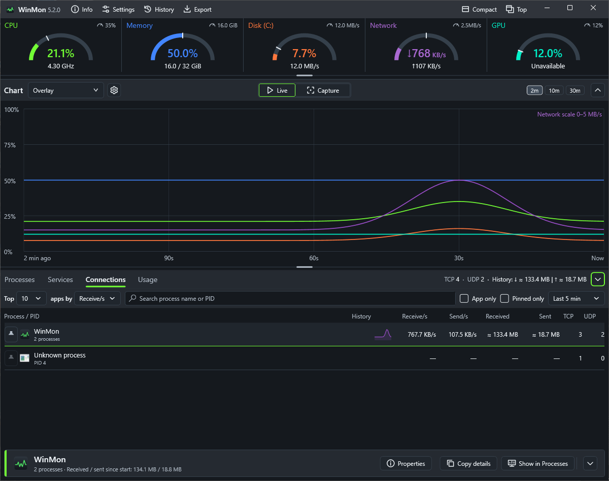
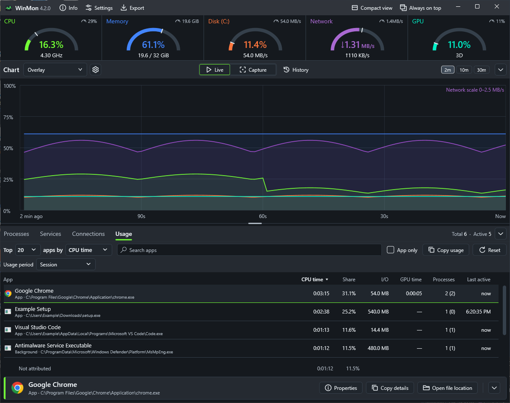
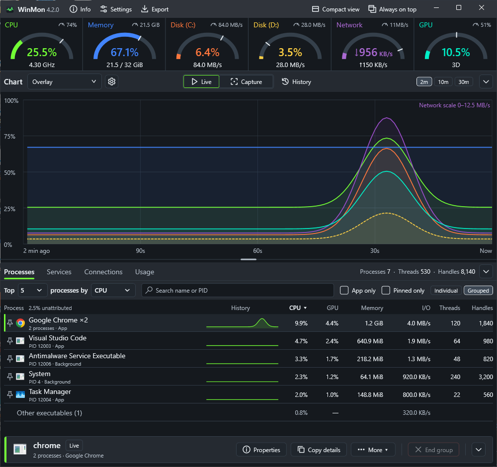
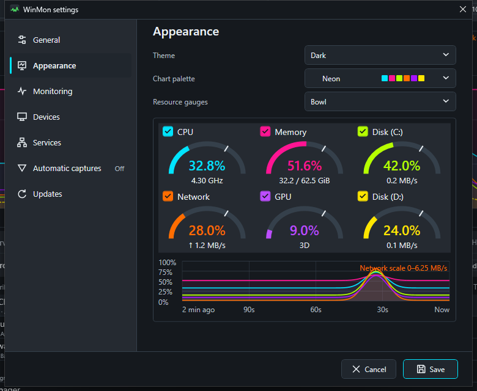
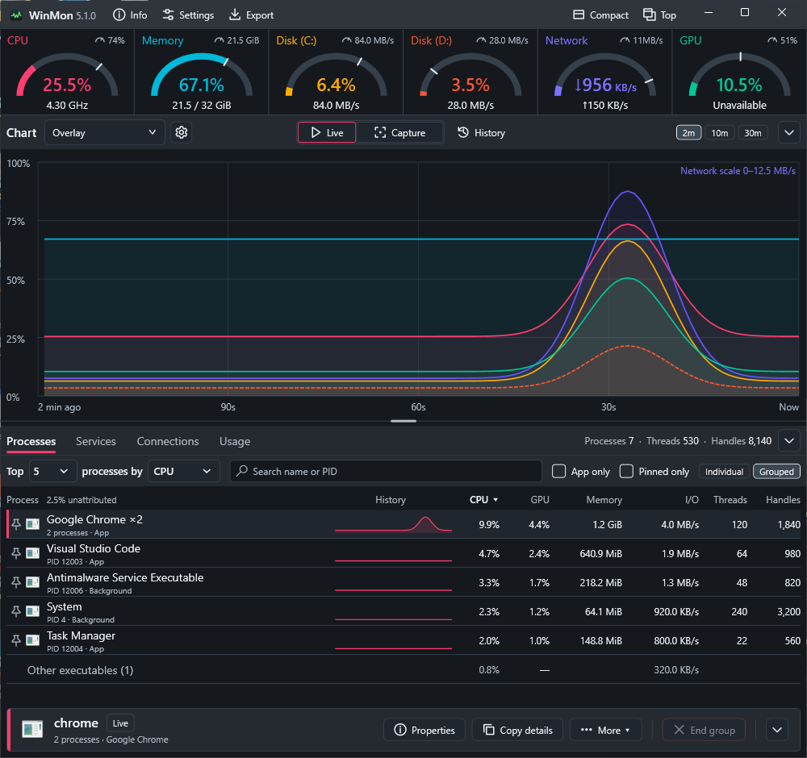
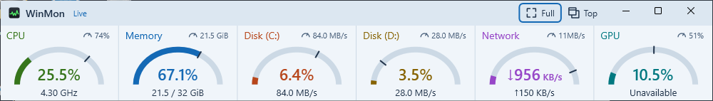
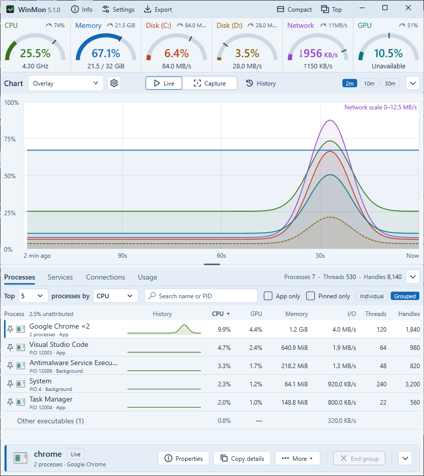

# WinMon examples

[Download WinMon](https://github.com/galenblakeman/WinMon/releases/latest) · [Overview](../../README.md) · [User guide](../USER-GUIDE.md)

- [Find what was busy during a CPU spike](#investigate)
- [Record the next spike while you're away](#record-the-next-spike)
- [Find which app is sending data](#find-which-app-is-sending-data)
- [See whether a service's workers are busy](#see-whether-a-services-workers-are-busy)
- [See what used CPU after an app closed](#see-what-used-cpu-after-an-app-closed)
- [Keep an app in view as rankings change](#keep-an-app-in-view-as-rankings-change)
- [Keep live readings visible in less space](#keep-live-readings-visible-in-less-space)
- [Appearance examples](#appearance-examples)

## Investigate

### What was busy during that CPU spike?

1. In Full view, choose **History** in the title bar. It opens at the CPU peak in the retained recording. Click another point on the timeline if the slowdown happened earlier.
2. Open **Compare periods**. In this recording, the first Chrome process averages 22.9% CPU before the spike, 52.1% during it, and 26.2% afterward. That's the largest change in the table and gives you a process to investigate.
3. To keep that part of the recording, choose **Save incident…** and select a time span.

Expand **Events** to see Windows events near the selected moment. Use **Crashes** to look for recurring failures on the timeline.

If the spike is still on the main chart, [click it to inspect that moment in Capture](example_snapshot.png). The top gauges stay live. For an older spike, try **History → Longer trends**. Select the minute peak and use **Open detailed history** if it is still retained, or **Find saved incident** to look for an automatic recording that covers it. [History and retention details](../USER-GUIDE.md#catch-the-spikeeven-after-it-passes).

## Record the next spike

Set WinMon to save the evidence when Chrome gets busy while you're away.

1. Open **Settings → Automatic captures** and turn on **Automatic captures**.
2. Under **Apps & services**, choose **Add rule**. Set **Target type** to **Executable** and **Metric** to **CPU**, enter `chrome.exe`, and set a threshold and duration. Choose **Add to list**, then **Save**. The rule measures CPU as a percentage of one logical processor and combines matching processes.
3. After the rule fires, choose **History → Open incident…** and open the matching `.wmincident` file. History opens at the trigger so you can review the readings around it, even after it has rolled out of recent history.

WinMon saves a text report alongside the incident. [Automatic capture settings and saved reports](../USER-GUIDE.md#automatic-captures).

To catch sustained heat instead, configure a temperature rule under **Built-in triggers**. It uses a Celsius threshold and requires a reading from the chosen sensor. [Temperature trends and captures](../design/TEMPERATURE-HISTORY.md).

## Find which app is sending data

1. Open **Connections**. With the optional desktop network monitoring service enabled, choose **Send/s** to rank apps by recent upload rate.
2. Compare **Send/s** with **Sent** for the selected traffic period. In the example, WinMon's illustrative row shows 107.5 KB/s and about 18.7 MB sent over the last five minutes.
3. Select an app and choose **Properties** to see its TCP connections and UDP endpoints. You can inspect endpoints with the monitoring service off.

Choose [Focus: Network](example_focus_network.png) from the **Chart** menu to compare the selected adapter's download and upload over time. The per-app numbers in Connections cover all adapters. [Connection and traffic measurements](../USER-GUIDE.md#see-which-apps-have-network-connections).

## See whether a service's workers are busy

1. Open **Services**, find the service, and expand its row to see the host process and observed workers.
2. Turn **Workers** on and compare the parent total with the child rows. Here, Build Agent shows 4.5% CPU in total. Its host accounts for 1.0%, and its two workers account for the other 3.5%. Turn **Workers** off to measure the host by itself.

Services sharing a host appear under a combined host total. [How WinMon identifies workers and reports shared hosts](../USER-GUIDE.md#follow-windows-services-and-their-workers).

## See what used CPU after an app closed

1. Open **Usage**, set **Usage period** to **Session**, and sort by **CPU time**. In the example, Example Setup used 2 minutes and 38 seconds of CPU time and has zero processes still running.
2. Check **Not attributed** for busy CPU time that WinMon couldn't assign to an app. Choose **Copy usage** to keep a plain-text summary.

Use **Day** or **7 days** for recorded activity across launches. [Daily and weekly Usage](../USER-GUIDE.md#daily-and-weekly-usage).

## Keep an app in view as rankings change

1. In **Processes**, choose **Grouped** and search for Chrome. The example brings two Chrome processes into a single row so you can see their combined CPU use.
2. Click the pin beside the group and clear the search. The group stays above the rankings without using a Top slot.
3. Turn on **Pinned only** to see just your watch list. Grouped pins follow the executable when it launches again.

When you need a specific PID, switch to **Individual**. See [search with App only enabled](example_apps_only.png), [pins above the live rankings](example_pinned.png), or [Pinned only in Individual mode](example_pinned_only.png). [Search, filters, and pin behavior](../USER-GUIDE.md#find-the-process-you-need).

## Keep live readings visible in less space

1. Choose **Compact** in the title bar to keep live gauges and peak marks visible in a short window.
2. To check a detail such as disk latency, drag the divider below the meters down. You can also focus the divider and press **Down** to expand the details or **Up** to collapse them.
3. Choose **Full** to bring back the chart and activity tabs.

In Full view, use the [live dashboard](example_individual.png) to compare the current readings with recent history. Choose [Small multiples](example_small_multiples.png) to give each resource its own scale on a shared timeline. [Chart options](../USER-GUIDE.md#your-system-at-a-glance).

## About these examples

Click any preview to open the full-size image. The windows show illustrative identities and measurements. The process dashboard, History, chart and Compact views share one recording. Services, Usage and Connections use separate fixtures. Connections uses synthetic traffic. The captures include the Windows-composed caption buttons and use installed app icons where available.

Captured November 27, 2026, with **WinMon 5.2.0** on Windows build **26300.10075**, x64. The main examples use the desktop build. The Store Settings image comes from an unpackaged build with `StoreBuild=true`.

[Regenerate and verify the examples](REGENERATING.md).

## Appearance examples

Show themes, palettes, and window variants

Open **Settings → Appearance** to preview a theme, chart palette, and gauge style together. [Customize WinMon](../USER-GUIDE.md#make-it-yours).

**Themes and palettes**

**Window variants**

The Store manages updates for Store builds, so their Settings omit the GitHub Updates section.

